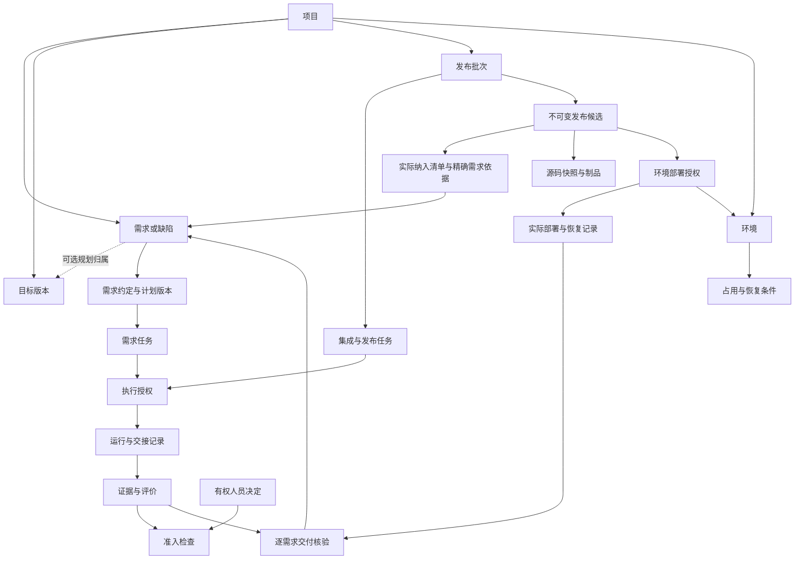

# CimiLoop 业务对象与协作闭环设计 v0.1

> 日期：2026-10-02。
> 状态：业务设计来源；当前 V1 选择已由[可执行设计与实施计划](../implementation/CimiLoop-V1可执行设计与实施计划-v0.1.md)收敛。本文保留原提案和场景推演，字段、枚举、命令、迁移及任务以实施基线为准；不表示功能已实现。
> 流程依据：[AI Native 软件研发流程](AI-Native软件研发流程-v0.1.md)，包括 D-165–D-172 对紧急修复、环境恢复、接续执行和责任的修订。
> 阅读方式：第 1–3 节确定产品边界和对象，第 4–6 节确定状态及操作，第 7–9 节检查交互与场景，第 10–12 节列出实施顺序和专项文档调整。

任务 / 授权的实际操作与边界见[任务、授权与预算](../implementation/CimiLoop任务授权与预算-v0.1.md)。executor只声明绑定执行者使用常规授权，不是Human责任角色；Task持久用量不因重建WorkItem清零，创建授权不启动Runtime。

## 1. 设计目标与适用性

CimiLoop 帮助人和 AI 回答：当前承诺是什么，谁在做什么，哪些结果已被证明，下一步由谁决定，多条需求如何共同发布，以及中断后怎样继续。

采用三条关联的业务线：单条需求推进、项目级集成发布、环境占用与实际运行。任务、授权、执行、证据和决定连接三条线；N1–N5 仍是流程与责任框架，不直接成为系统的五个状态或五个独立模块。

| 已确认、继续遵循的约束 | 本轮提出的承载设计 |
|---|---|
| 需求与缺陷从录入到交付保持同一身份；目标版本可选 | 需求详情聚合展示自身事实和关联发布结果，不创建第二份交付记录身份 |
| 按条实施、按批发布、按条确认完成 | 发布批次组织过程，发布候选固定内容，部署授权与实际尝试分离 |
| 独立评价、确定制品、生产观察、必要知识义务 | 验收与证据绑定精确对象；完成检查纳入观察结果和未完成义务 |
| 常规授权可复用，紧急修复有明确例外 | 规则依据与具体执行授权分开，生产基线可直接形成紧急候选 |
| Kernel 控制状态和授权，外部系统保留实际事实 | 业务状态由 Kernel 提交；Git、Runtime、CI/CD 的实际结果通过核对和证据进入流程 |

本提案不改写已确认流程。新对象划分、中文状态和交互是本轮建议，不能因写入本文就视为原有代码已支持。现有专项架构中与流程一致的原则继续保留；需要改动的部分在第 11 节列出，尚未整体同步。

## 2. 产品边界与 V1 使用方式

### 2.1 首版建议：本地运行，验证团队流程

沿用现有 Embedded Solo Mode（嵌入式单人模式）作为首版运行基础，主要使用者是负责推进交付的开发者或技术负责人。他在本机组织多条需求和一次共同发布，可在获得相应指派时兼任多个责任，AI 承担获准的分析、执行与评价。

单人运行不把真实产品、测试或发布责任自动集中到操作者。首版只把已验证身份的决定作为该 Actor 本人的决定；导入外部评审材料时记录来源和实际作者，它是外部依据，不得冒充其他人的系统签名。需要独立人员正式批准而当前能力无法取得有效决定时，保持阻塞，或按项目明确允许的例外机制处理，不能通过勾选“代确认”绕过。

这是本轮建议的 V1 范围：先证明同一内核能够承载团队流程，再扩展多人登录与协作。如果首个试点明确要求产品、开发和测试分别在系统中操作，应提前实现最小共享服务与身份校验，而不是以单人模式宣称多人流程已落地。对象身份、责任归属和发布关系不应因部署模式改变而重建。

### 2.2 CimiLoop 与现有工具的职责

| 参与者 / 系统 | 负责 | 接口边界 |
|---|---|---|
| 人 | 需求、技术、验收、发布及风险决定；可直接实施 | 明确身份、责任范围和所决定的版本 |
| CimiLoop Kernel | 维护业务事实、校验动作条件、生成受控执行、记录结果与恢复断点 | 接收有业务含义的命令，不开放任意改状态 |
| Agent Runtime | 读取上下文、调用工具、实现和分析 | 接收执行授权，返回产物、结果与原始依据，不自授权限 |
| Git / CI / 制品库 | 代码与构建实际事实 | 提交、来源、摘要、报告及可核对外部引用 |
| DevOps / 环境提供方 | 实际部署、资源和环境状态 | 支持授权校验、幂等或状态查询；不能仅返回一句“已完成” |
| 工作台 / CLI | 呈现事实、提交动作、显示下一责任人 | 共用 Kernel 规则，不各自维护审批或状态 |

首版不建设通用聊天、编辑器、任意拖拽工作流、新 CI/CD 或凭据系统。外部执行能力不足时，可先用有来源的人工执行记录验证语义，但不得将手动演练描述为自动化能力已实现。

## 3. 核心对象与关系

### 3.1 用户日常接触的对象

| 对象 | 职责与生命周期 | 核心关联 |
|---|---|---|
| 项目 | 保存协作规则、责任指派、容量和环境引用 | 拥有需求、目标版本、发布批次；不把所有操作锁进一个项目大事务 |
| 需求 / 缺陷（内部 Change） | 表达一项可独立验收的承诺，从录入到完成保持身份 | 当前需求约定、计划、任务、实际候选纳入和交付结论 |
| 目标版本（Target Version） | 表达希望在哪轮交付的可选规划 | 需求规划归属及历史；与发布批次不强制一一对应 |
| 任务（Task） | 持久工作单元，表达具体预期结果和验证方法 | 需求计划，或项目级集成发布工作范围；执行尝试不是任务 |
| 发布批次（Release Batch，建议名） | 组织一次交付过程、窗口、负责人、拟纳入范围和问题处置 | 多个不可变候选、当前选定候选、环境授权和交付收尾 |
| 发布候选（Release Candidate，建议名） | 固定本次可被验证或发布的来源、制品及实际纳入清单 | 属于一个批次；可供测试与生产的不同授权引用 |
| 环境（Environment） | 定义部署目标及其使用约束 | 占用记录、配置和数据条件、观测到的运行事实 |

需求池、看板、待办、版本页面和发布页面都是查询视图。它们组合上述事实，不成为第二份需求或发布状态权威。

### 3.2 支撑协作的记录与对象

| 对象 / 记录 | 核心职责 | 约束 |
|---|---|---|
| 需求约定 / 计划版本（Contract / Plan） | 保存已确认目标、验收和实施方式 | 历史版本不可改写；下游引用确切版本 |
| 执行授权（Work Item） | 规定谁可在何种依据、范围、预算和停止条件下执行 | 关联持久任务及作用域，边界改变创建新授权 |
| 运行记录（Run） | 一次人或 AI 执行尝试的结果和外部引用 | Agent Run 保留运行时详情；人工操作也有事实依据，不伪装成 Agent Run |
| 上下文与交接记录 | 固定输入来源，保存中断点及接续检查 | 交接摘要不覆盖实际代码或最新有效约定 |
| 证据 / 评价（Evidence / Evaluation） | 保存原始观察和基于证据的判断 | 自检、独立评价、验收和发布准入结论分别标识 |
| 决定（Decision） | 记录有权人员对具体版本的选择 | 批准不改写事实，过期决定不能授权新候选 |
| 部署授权（沿用内部 Release） | 允许某候选进入某环境，限制窗口、操作和恢复范围 | 不同时承担发布批次身份；测试授权不是生产授权 |
| 部署 / 恢复尝试（Deployment / Recovery） | 保存一次外部动作及其观测历史 | 请求、执行中、成功、失败、未知分清；历史观测追加，不覆盖 |
| 环境占用与恢复记录 | 说明当前谁可使用环境、交接条件和恢复依据 | 业务占用与短期执行锁分别管理 |
| 收尾义务 | 跟踪必要知识更新、紧急修复同步及遗留处置 | 首版复用任务及完成条件，不要求新建通用义务管理模块 |

这里的对象是逻辑职责，不意味着每项都新增数据库表或独立服务。保留现有 Contract、Plan、Work Item、Evidence、Decision 等机制；新增重点是批次、候选及环境交接的明确业务边界。

### 3.3 对象关系

同一需求可进入多个候选和多个批次；同一候选纳入多条需求。候选属于一个批次，其源码快照或制品可以被其他批次引用。批次终止不终止需求；需求延期也不自动终止整个批次。尚未明确归属候选的集成工作可先以项目级任务组织，避免为一次共同构建伪造需求。

### 3.4 “一次发布”的边界

例如批次 B-10 拟交付 A、B、C：候选 C1 固定三条需求的实际实现；B 失败且 A 依赖 B，经过决定从实际内容移除 A、B，再构建候选 C2。B-10 的历史保留 C1、C2，当前选定 C2；C1 的证据和批准不会自动转给 C2。最终 C 交付，A、B 保留原身份安排后续。

发布批次可以更新当前计划和选定候选，但每次变化有修订记录。发布候选一经形成，来源、制品和实际纳入清单不可原地改写；验证、决定和部署作为后续关联记录追加，不修改候选内容。

实际纳入清单固定每条需求的身份、适用需求约定与计划版本、实现来源及依赖；验收结果另以精确候选和这些版本为依据追加。构建脚本、配置或迁移等实际变化也须有可追溯来源，不能只列页面功能。无法解释的额外内容阻止候选放行。仅调整目标版本不改写候选，也不自动使有效实现证据失效。

在构建前先固定源码快照和拟纳入依据，以批次或项目任务授权构建；构建成功并核实来源与实际内容后形成候选，避免“构建需要候选，候选又要求构建完成”的循环。构建失败保留任务与失败结果，不伪造一个完整候选。已有 N3 制品与最终快照、范围及构建条件一致时可以复用，不要求仅因切出 release 分支重新构建。

现有 Publication Version（发布版本）的不可变来源、制品及清单语义可承接到候选；最终实际发布引用的是某个已部署候选，不能另建内容相同但失去来源的一份“正式版本”。更名、字段及迁移另行设计；内部 Release 继续表示环境部署授权，界面明确标为“部署授权”。

## 4. 状态归属与变化规则

### 4.1 需求状态应表达自身进度

需求自身保留以下业务位置；本提案阶段尚未确定的英文协议名及 M0 迁移，现已由实施基线第 4、7 节收敛：

| 位置 | 进入依据 | 允许继续的主要工作 |
|---|---|---|
| 待澄清 | 已录入并保留来源 | 调查、确认目标、拆分或终止 |
| 待实施 | 需求约定已确认 | 规划、验证关键未知、安排开工；尚未获执行授权不能实施 |
| 实施中 | 计划与执行边界有效且已开工 | 人或 AI 实施、自检、独立评价、修复 |
| 待交付 | N2 必要评价通过，具备安全集成条件 | 参与候选集成、验收、发布及收尾；仍可显示“生产已通过、知识更新待完成” |
| 已完成 | 本条实际可用、验收及约定生产检查通过，必要义务完成，需求负责人确认 | 长期效果观察和独立后续改进 |
| 已终止 | 取消、已拆分或被取代的处置及副作用核对完成 | 保留原因、溯源与遗留记录，不计为已交付 |

等待决定、阻塞、暂停是运行条件，失败另有失败事实和待处理事项。一个需求可同时有多个阻塞或待决定原因；界面展示最需要处理的事项，但不能因关闭其中一项就解除全部限制。

原 lifecycle_state 与 delivery_status 中重复表达测试、待发布和生产通过的部分，建议改为引用候选及逐条交付核验后的派生展示。保留需求自身的完成决定；不再同时维护两套可独立编辑的“已完成”。长期 outcome_status 继续单独观察，不阻塞已满足约定的交付关闭。

尚未完成的需求因代码问题必须重新实施时，基于影响判断回到实施中并处理失效的评价；仅因环境占用或发布排期变化，不回退已经有效完成的 N2。新候选使旧结论不再适用时，保持历史结果并显示本次缺口。已完成需求后续发现问题时，保留原交付历史并关联新的缺陷或改进及当前影响，不静默回写原来的完成决定。

### 4.2 批次过程与候选结果分开

批次界面建议呈现“准备 → 验证 → 待上线 → 生产观察 → 收尾 → 结束”，允许修复产生新候选返回验证，或明确终止。这个阶段展示由当前选定候选、决定、实际部署、观察及收尾事实计算；批次是否终止、当前选定候选等关键选择有独立业务动作和记录。

候选自身保持不可变；“测试通过”“生产观察中”“已被替换”是它关联事实的展示，不通过改写候选内容表示。批次可以展示已排除需求及原因，但当前候选清单只陈述实际内容。某个候选已经部署后再换候选，必须保留生产仍运行旧候选的事实。

批次正常结束要求实际交付核对和本批必要收尾完成；候选生产验证通过不等于所有原计划需求完成。终止批次必须核对在途动作及实际环境，有生产影响时完成获准恢复与验证；没有操作生产时记录核实依据，无须伪造恢复动作。

### 4.3 环境状态分三部分呈现

| 部分 | 例子 | 权威依据 |
|---|---|---|
| 使用安排 | feature 验证窗口、批次 B-10 占用、紧急批次抢占 | Kernel 中的占用与交接决定 |
| 目标内容 | 计划部署候选 C2、配置 K2、结构 S2 | 当前有效授权与目标版本引用 |
| 观测到的实际内容 | 实际仍为 C1，迁移执行结果未知 | 外部状态查询、部署和核对记录，带观测时间 |

目标不替代实际。环境不可达或结果过期时标记未知并阻止依赖该事实的动作。占用的业务有效期跨越多次部署；一次执行锁或进程租约过期不意味着环境可以释放。

### 4.4 任务、授权和运行的区别

任务只有在预期结果及验证满足时才能达标；Work Item 管当前允许执行的边界；一次 Run 成功只能结束该尝试。修复可沿用持久任务，并产生新的修复授权和运行。相同授权内重试仍受累计预算约束，不通过重启会话重置预算。

人工修改同样关联任务、代码差异及必要原因。接续前核对工作区、需求、计划和授权：条件仍有效时可继续，授权边界变化时生成新 Work Item；新的运行使用新的上下文快照，旧运行记录保留。

## 5. 关键动作、责任和完成依据

以下是业务动作清单，不是最终 API 名称。每个写入需要 Actor、目标与期望版本、幂等标识，Kernel 校验当前条件后提交事实。

| 动作 | 发起 / 确认责任 | 关键条件 | 写入事实或后续工作 |
|---|---|---|---|
| 录入与澄清 | 有录入权限的参与者；需求负责人确认约定 | 保留原文、来源、范围、验收；未知不能静默补齐 | 同一 Change，版本化约定；经确认拆分产生平级记录 |
| 安排开工 | 交付协调人排序，技术负责人确认方案 | 在制容量、依赖、有效计划与执行边界 | 开工决定、任务及执行授权；不自动授予部署权 |
| 沿用常规授权 | 执行者请求，Kernel 核验 | 规则有效，当前任务、风险、环境和预算在范围内 | 引用既有授权依据的具体 Work Item，无须重复人工点击 |
| 提交自检 / 请求评价 | 执行者提交，独立评价者检查 | 固定代码及需求依据、原始证据、独立上下文 | 自检、独立评价及缺口；待验证项有接续人 |
| 接纳共同集成 | 有权开发者执行，技术责任人处理冲突 | N2 必要评价通过、依赖和安全合入条件明确 | 合入事实、源码快照、共同构建与验证任务 |
| 形成并选定候选 | 开发准备；发布负责人决定进入 N4 | 成功构建、实际纳入范围、最低运行检查和验证准备；紧急来源按例外核验 | 不可变候选与批次当前选择；环境交接任务 |
| 确认验收 | 各需求负责人、涉及产品行为的产品负责人、测试负责人 | 当前候选上的验收与质量依据，未覆盖项明确 | 各自负责的结论，不合并成一个无来源的“通过” |
| 批准上线 | 发布负责人 | 确定候选、环境条件、验收、风险、观察窗口与恢复安排 | Decision 与部署授权；执行前再次校验适用性 |
| 执行部署 / 核对 | 获准 Operator 或外部流水线 | 当前授权、环境占用、外部权限及幂等条件 | Deployment 与观测；未知进入核对，不能盲目重试 |
| 修复 / 剔除延期 | 技术负责人核对可行性，相关需求负责人确认承诺变化，发布负责人决定本批范围 | 实际修改、依赖和副作用可处理 | 新快照、新候选与适用性判断；不靠取消勾选剔除代码 |
| 切换 / 释放环境 | 发布负责人安排，环境恢复负责人执行 | 无未核实在途操作、配置数据兼容或可恢复、生产观察及释放条件满足 | 新占用及恢复事实；明确是否仍有生产观察 |
| 确认完成 | N1 确定的需求负责人 | 实际可用、必要验收与生产检查通过、知识和同步义务完成 | 逐条完成结论；与批次是否结束分别判断 |
| 暂停 / 恢复 / 终止 | 相应需求或发布责任人按作用域决定 | 核对在途工作、副作用及清理；恢复时核对容量与基线 | 保留进度、原因和恢复条件，不回写历史 |

职责映射建议：需求负责人承接 Intent Owner 的范围与验收责任；Change Owner 管推进，可由同一人兼任但不自动获全部权限；交付协调人承接 Flow / Portfolio Owner；技术和发布责任沿用对应 Owner。测试负责人说明本批质量事实，不自动等同于维护长期规则的 Domain Policy/Eval Owner。具体最小角色集合和委托字段在角色专项中重对齐。

## 6. 证据、授权、并发与恢复

### 6.1 准入检查只回答具体动作

界面回答“为什么现在不能继续”及“谁补什么”，内部沿用 ALLOW、REQUIRE_HUMAN、NEED_MORE_EVIDENCE、DENY。N2 评价、N3 形成候选、N4 上线和 N5 关闭分别检查所需事实，不用一个全局信任分数替代。

证据关联适用的需求和计划版本、源码或制品、配置、数据条件、环境、场景及时间。复用旧结果须记录差异及适用性判断；修改部分内容不要求全量重测，也不能默认全部仍有效。仍适用的关键失败不能被其他通过数量抵消。

评价者直接读取确认后的验收与原始依据。AI 评价使用独立会话及按角色组装的上下文，不继承实现者完整推理；自检和独立评价分别标识。高风险判断保留专业人员实际参与的证据。

### 6.2 常规授权与上线决定

预先批准的常规范围作为版本化授权依据，可覆盖多次满足条件的任务；具体 Work Item 仍固定本次目标和边界。撤销、过期、风险或条件变化时，尚未执行及重试的动作须重新校验。不能把一次需求批准、计划批准或测试环境授权当作生产权限。

生产决定绑定候选、实际清单、环境、关键配置数据条件、窗口及恢复边界。候选变化时新建或重新取得相应授权，旧决定永久保留但不再对新对象生效。记录“接受非阻断风险”不能把必需验收的失败改成通过。

### 6.3 候选与在途部署的并发控制

选定候选或批准发布时使用对象修订检查，防止批准期间批次已切换候选。部署执行边界再核对候选、授权、环境占用和撤销状态，不能只在任务入队时检查。

环境切换采用可识别当前占用代次的执行校验，或外部流水线具备等效串行隔离；旧占用下排队的操作不能晚到覆盖新环境。已经发出的外部动作必须等待结束、确认取消或查询真实状态，不能只丢弃迟到回调就宣称环境已保护。外部提供方无法保证这些条件时，保持环境阻塞并由人协调。

环境引用到同一真实资源时须共享互斥边界；不能因为分属不同项目就在各自本地拿到“独占”。V1 对无法协调的外部使用明确标记限制，切换前要求核对。

### 6.4 事务与外部恢复

沿用现有 Revision、幂等、Event 与 Outbox 的提交模式。外部动作在事务提交后执行；响应丢失时按操作标识查询，不重新创建同一副作用。重启重建待执行、待核对及待决定工作，不把 Run 恢复等同于环境事实恢复。

一次业务命令有明确主对象。候选发布结果传播到多条需求时逐条幂等求值，保留尚未核验的记录；不要求一个跨全部需求的大事务，也不在界面暂未更新时显示整批需求已完成。完成决定提交时再校验所引用证据与当前需求版本。

长观察窗口提前释放环境，需要独立验证环境或已验证的按需重建能力、恢复时限与责任人。生产仍显示“观察中”；发生失败或未知时不能套用此例外。换回旧候选还要恢复适用配置、结构及必要测试数据，环境恢复不等于只部署旧包。

## 7. 关键页面与操作路径

首版采用列表、详情和明确动作，不以大屏流程图替代实际协作。技术标识可以下钻查看，日常使用需求、任务、候选、验收、发布和环境等业务语言。

| 页面 | 首屏必须回答 | 主要动作 | 事实来源 |
|---|---|---|---|
| 项目工作台 | 哪些工作需要处理，谁负责，哪里积压，在制是否超限 | 录入、排序、开工安排、处理阻塞与待决定事项 | 需求、任务、容量、环境与决定的派生汇总 |
| 需求池 / 目标版本 | 有哪些需求缺陷，计划归属是什么 | 筛选、分配负责人、调整规划归属 | 同一 Change 台账，不另建需求身份 |
| 需求详情 | 当前承诺、任务、证据和下一责任人；关联哪个候选，实际交付多少 | 澄清确认、计划确认、请求评价、查看交接、确认交付 | 需求自身事实及候选纳入、验收、交付关联 |
| 发布详情 | 当前候选、实际与原计划差异、各条验收、环境及生产观察 | 形成 / 切换候选、发起验证、修复或剔除、批准上线、终止与收尾 | 同一批次及其候选、决定、部署、观察记录 |
| 环境概览 | 谁占用、想运行什么、实际运行什么、是否可恢复 | 请求占用、交接、核对、恢复、按条件释放 | 占用、外部观测、配置数据条件及授权 |
| 执行详情与待办 | 当前任务、权限、输入、运行结果、阻塞原因和接续人 | 查看证据、停止或请求接续、处理具体决定 | Work Item、Run、交接、Evidence 与 Decision |

每个动作入口显示目标及依据：例如“批准候选 C2 上线”，同时展示实际纳入清单、必要检查、剩余风险、环境与窗口；不只写一个脱离对象的“同意”。信息不足时显示缺项与责任人，不仅禁用按钮。

同一共享发布决定在工作台、发布页和多条需求详情中使用同一引用。需求详情可打开该决定，但不能只显示当前需求就让人批准整批。修改清单时先展示实际代码差异与依赖，再生成候选，不能把多选框变化当作发布内容已改变。

需求详情的交付摘要必须区分“原计划纳入”“当前候选实际纳入”“本条已验收”“生产已验证”“本条完成”。允许同时出现“生产已验证，修复同步待完成”；允许批次中 C 已完成而 A、B 已延期。

## 8. 三个端到端场景推演

以下是设计推演和未来验收要求，不是已运行的系统测试。与[流程执行记录与演练](../practices/AI-Native研发流程执行记录与演练-v0.1.md)中的三个场景对应，编号均为示意。

### 8.1 普通低风险修改，中途更换执行会话

背景：需求 R-01 修复列表空结果提示，无数据或权限变化，团队已批准相应目录内的常规编辑及本地检查。

| 步骤 | 对象与事实变化 | 用户应看到 |
|---|---|---|
| 录入与确认 | 创建 R-01，需求负责人确认约定 K1 和验收；技术负责人确认计划 P1 | 同一需求从待澄清进入待实施，尚未因确认需求而获得部署权 |
| 开工 | 协调人安排容量；任务 T1 获得执行授权 W1，开始运行 A1 | 实施中，显示任务、边界和停止条件 |
| 中断与接续 | A1 保存源码 S1、未提交差异引用、证据 E1 及剩余预算；新会话 A2 核对实际工作区与 K1/P1/W1 | 接续检查已完成；未发生边界变化时不重复请求人工授权 |
| 独立评价 | 独立会话 V1 读取 K1、最终源码 S2 及原始证据，提交评价；必要检查满足 | 需求待交付，明确 N3 接续项，不显示需求已完成 |
| 集成与候选 | 项目任务合入 feature 快照 S3，构建制品 A3；核实实际纳入后形成批次 B1 的候选 C1 | N3 必要检查与 N4 准备；是否提前部署共享环境按风险决定 |
| 验收与发布 | 测试授权 L-test 引用 C1；相关负责人完成验收；发布负责人作出决定，生成 L-prod | 测试和生产引用同一 A3，各有独立环境授权 |
| 生产观察与完成 | 部署事实核对一致，约定检查及窗口通过，知识任务达标；需求负责人确认 | R-01 已完成；批次完成必要收尾后结束；长期效果另列 |

未来验收断言：Run 成功不能完成 T1 或 R-01；接续基线不匹配必须显示差异；独立评价缺失不能进入安全集成结论；同一发布不能因打开多条详情而重复部署；重复完成命令返回原结果。

### 8.2 依赖需求延期，保留独立需求发布

背景：A 的导出入口依赖 B 的导出能力，C 是独立修复。三者已进入批次 B2 的候选 C1，B 的必需验收失败，窗口内无法修复。

1. 记录失败证据并定位到 B 的验收、C1 和实际环境；相关准入不得通过。依赖 A→B 明确为发布时需要 B 的能力有效，不只写“等 B 完成”。
2. 发布详情展示 A 也受影响。发布负责人确认本批移除 A、B，相关需求负责人知悉延期；若选择改变承诺，则先修订需求约定，不能直接降低失败标准。
3. 原 C1 保留三条需求及失败记录。修复任务从实际发布来源中剔除 A、B，核对共享接口、配置及数据迁移影响；目标版本调整只改变计划，不代替这一步。
4. 成功构建和核对后形成 C2，实际纳入仅 C。批次选择 C2，记录与 C1 的差异、可复用证据及必须补查项；C1 的决定不能自动授权 C2。
5. C2 完成必要验证与新授权后发布；C 单独完成，A、B 保留身份和有效进度，等待容量与后续批次。feature 内保留的后续工作不因发布剔除被自动删除。
6. 若不能安全剔除，则不形成可发布 C2；保留问题或终止批次。未操作生产时核实未受影响后交接环境；已影响生产则按获准安排恢复并验证。

未来验收断言：不能在 C1 上删除清单条目后继续使用其制品与批准；不能移除 B 却忽略依赖 A；不能因 B2 结束完成 A、B；批次终止不自动取消三条需求；C2 的清单必须覆盖所有实际变化及必要依赖，无法解释的额外内容阻止放行。

### 8.3 下一批验证期间发生紧急生产故障

背景：生产实际运行候选 P0，feature 已演进到 F2；常规批次 B3 的候选 C3 正在共享环境验证，测试数据库已迁移为 D2，与生产对应的 D0 不兼容。

1. 建立紧急缺陷 H，快速确认故障影响、修复目标和授权。生产内容以查询结果、制品来源及配置数据条件为依据，不取当前 feature 分支头。
2. 技术负责人确认基线及范围，发布负责人选择紧急路径。创建紧急批次 BH，从 P0 对应提交形成最小修复、独立评价和新制品，核对后形成候选 CH；不要求先进入 F2。
3. 暂停 B3 的环境验证并保存 C3、D2、配置、测试数据恢复依据及已有证据。协调人记录被影响工作与容量。核对在途动作，阻止旧占用下的排队部署继续写环境。
4. D2 不能直接运行旧版验证：采用经过验证的 D0 对应测试数据恢复方案，或另用隔离环境。环境恢复负责人检查实际条件，CH 才能进入测试验证。
5. 必要测试及验收通过后，发布负责人批准 CH 进入生产。部署成功先进入生产观察，必要窗口通过后记录生产修复有效；若结果未知先核对，不重复发布。
6. H 的计划保留同步任务：把等效修复纳入 F2 及受影响待发布来源，用故障回归证明修复保留。生产已稳定但同步未完成时，H 显示待收尾，不关闭。
7. B3 恢复环境及测试数据。若修复改变其代码来源，形成 C4，重新核验受影响证据和授权；C3 历史不改写。相关问题不适用时保留证明，无须机械复制提交。
8. H 完成必要同步、知识和事故收尾后由需求负责人确认完成；B3 按自己的验收和发布窗口继续。

未来验收断言：CH 来源不含未发布的 F2 内容；环境交接包含数据兼容依据；紧急抢占不删除 B3 候选和证据；旧流水线不能晚到覆盖；H 的关闭和受影响下一批发布均检查同步义务。

若 CH 必须等待跨日任务观察，提前释放环境只能在即时检查通过且已有适用替代环境或验证过的重建能力时获准。此时 CH 仍在观察，H 未达到生产验证终点；不能因环境已交回 B3 就显示 H 已完成。

## 9. 从流程要求到产品能力的核对表

| 流程要求 | 本提案承载方式 | 未来最小可验证结果 |
|---|---|---|
| N1 一句话录入、平级拆分 | 同一 Change 身份、约定版本与拆分关系 | 来源已拆分不计交付，不级联关闭新需求 |
| 开工、在制容量 | 项目约定、排序与开工事实，含等待和暂停记录 | AI 空闲不能绕过容量开工；紧急插入保留影响 |
| N2 计划、常规授权与独立评价 | 任务、Work Item、独立上下文及 Evaluation | 任务与 Run 不混淆，同一执行会话自检不满足独立评价 |
| 中断接续 | 基线与交接记录、恢复前差异核对 | 换会话不丢预算、不覆盖他人改动、不沿用失效结论 |
| N2→N3 待验证项 | 带范围、风险、责任人与检查时点的验证任务 | 未知保持未知；影响安全合入的未知阻止接纳 |
| N3 共同集成与切出 | 项目级任务、固定快照、批次和候选 | 不为各需求复制构建；早期共享环境部署可按风险省略 |
| N4 逐条验收、整批决定 | 各条验收记录、共享发布 Decision | 技术类需求不强制无关产品审批，批准不复制到每条需求 |
| N4 修复、剔除和延期 | 新候选、依赖检查、规划归属历史 | 内容变化后旧候选和决定保留但不自动适用 |
| 生产检查与观察 | 候选环境证据、即时结果与观察窗口 | 即时检查通过不提前计为生产验证通过 |
| 环境释放与紧急恢复 | 占用代次、恢复依据、外部核对 | 未操作生产可终止释放；数据不兼容不得只切旧包 |
| 紧急生产基线修复 | 独立紧急批次、精确来源、同步任务 | 可以先修复生产；下一批不重引入故障 |
| N5 完成、知识与学习 | 逐条完成决定、收尾任务、效果记录 | 未完成知识或同步义务不能靠批次成功关闭 |
| 试运行度量 | 开工、等待、返工、完成与用量事实的查询 | 未知不填零，延期终止样本不被删掉，不重复累加重叠等待 |

## 10. V1 收敛与实施顺序建议

### 10.1 首版保留与延后

| V1 必须证明 | 可以延后 |
|---|---|
| 同一需求身份、持久任务、明确责任及确认依据 | 完整组织目录、实时多人编辑和消息平台双向同步 |
| 一个 Agent Runtime 的执行、独立评价及中断恢复 | 多 Runtime 同时调度和复杂自动路由 |
| 两条以上需求共同形成候选，逐条验收与完成 | 任意可视化工作流编排、跨项目复杂组合调度 |
| 一组测试与生产目标的部署授权、实际核对和观察 | 多地域、多租户及复杂灰度策略配置器 |
| 依赖延期、生产基线紧急修复、环境保护与同步 | 自动修复全部冲突、自动判断所有迁移可逆性 |
| 原始证据引用、知识收尾、最小等待及投入记录 | 自动知识晋升、复杂成本预测和大型效能仪表盘 |

复杂动作可以由获准人员处理，CimiLoop 仍须完整记录其条件、结果和未完成义务。V1 成功标准是三类场景在实际约束下可核对、可恢复地走通，不是界面上每个动作都已全自动。

### 10.2 按纵向能力推进，不立即沿用旧 M1–M5

下列保留业务切片的设计来源；当前已落实为实施基线的S1–S4、V1-01–V1-23任务及验收矩阵，技能包装与试点进入S1，OpenSpec可选，替代旧M1–M5的直接执行入口。

| 顺序 | 交付切片 | 退出依据 |
|---|---|---|
| 1 需求与执行闭环 | 在 M0 上增加需求约定、计划任务、责任决定、执行授权、自检与独立评价、交接 | 普通修改从录入走到可安全集成；原暂停、恢复、幂等与并发保证不退化 |
| 2 多需求共同候选 | 项目级任务、批次、不可变候选、实际纳入和依赖、验收与证据适用性 | 至少两条需求汇合，修复或剔除形成新候选，旧批准不能误用 |
| 3 环境与生产交付 | 占用保护、部署授权、外部核对、生产观察、恢复、逐条完成 | 同一制品晋升；超时、重启、在途部署和观察未完成不会虚假完成 |
| 4 异常与收尾验证 | 紧急候选来源、暂停下一批、配置数据恢复、修复同步及知识任务 | 三个端到端场景及异常断言通过，能导出核对证据和未完成项 |

每个切片通过同一业务命令服务 CLI 与最小界面；不先做一套只靠固定演示数据推进的业务状态。M0 的 Project、Actor、Draft、暂停恢复、Revision、Event 和 Outbox 设计作为复用基础，具体兼容性需实施时验证，本次没有执行代码测试或宣称迁移完成。

## 11. 现有专项文档的调整清单

| 材料 | 保留 | 需要重对齐的内容 |
|---|---|---|
| [整体能力架构](CimiLoop整体能力架构-v0.1.md) | 六个能力域、Kernel、Protocol、Adapter 分层 | 从主要围绕单 Change 扩展为需求、共享批次、环境三条关联业务线；补生产观察与收尾 |
| [核心领域模型](CimiChangeProtocol核心领域模型-v0.1.md) | 统一身份、版本、证据、决定、执行授权 | 批次与候选、候选纳入及基数、项目级任务归属、环境占用；明确 Publication Version 与候选及 Release 的映射 |
| [端到端状态机](CimiLoopChange端到端状态机-v0.1.md) | 受控迁移、异常回流、历史保留 | 简化需求自身状态，发布和环境独立表达；补观察、收尾、已拆分和延期；制定旧枚举迁移规则 |
| [角色与权限](CimiLoop角色与权限模型-v0.1.md) | Actor、Assignment、作用域与职责分离 | 需求负责人贯穿验收，测试结论责任，交付协调人，常规授权复用及独立人员批准的 V1 边界 |
| [验证与证据](CimiLoop验证与证据模型-v0.1.md) | Claim、Evidence、适用性和独立评价 | 按候选及各需求验收组织覆盖；配置数据条件、观察窗口、同步义务和关闭条件 |
| [上下文与知识](CimiLoop上下文与知识模型-v0.1.md) | 不可变上下文、来源权威、知识更新 | 工作区未提交差异、剩余预算、接续前核对、评价上下文隔离；批次和环境交接上下文 |
| [交付与 DevOps](CimiLoop工程交付与DevOps模型-v0.1.md) | 同制品晋升、授权与尝试分开、未知先核对 | 将即时检查与完整生产验证分开；环境释放、配置数据恢复、生产基线修复及同步；外部防覆盖能力要求 |
| [工作台与详情交互](CimiLoop工作台与变更空间交互模型-v0.1.md) | 熟悉的业务入口、共享决定、技术明细下钻 | 发布批次与候选对比、目标与实际环境、观察和收尾提示、容量及交接；取消重复状态编辑 |
| [存储与 Solo–Team](CimiLoop存储与Solo-Team演进模型-v0.1.md) | Store Port、事务、幂等、Event/Outbox | 批次和环境的并发边界、逐条交付结果传播、部署观测历史、导出和旧数据迁移 |
| [能力装配](CimiLoop能力装配模型-v0.1.md) | 能力声明和确定绑定 | 发现是否支持环境占用校验、取消、状态查询及数据恢复核验；缺能力时明确降级或阻塞 |
| [V1 范围](../plans/2026-09-19-cimiloop-v1产品范围与实施里程碑-v0.1.md)及 M1–M5 | M0 已有基础与纵向交付思路 | 按本提案及三场景重新拆范围、任务和退出条件；旧计划当前仍不直接执行 |
| [业务术语](../../CONTEXT.md)、协议及原型 | 已有项目、需求、任务语言和实现记录 | 术语已同步批次、候选与授权边界；Protocol 与真实工作台按当前任务实施，旧原型保持演示定位 |

2026-10-03对齐结果：专项顶部增加当前设计与实施约束，原讨论正文归入历史；术语、导航和入口同步。最小字段、命令、迁移和验收统一归入实施基线。V1-01/02协议与迁移基础已实现并验证，基础Kernel / Store / CLI执行v2，旧原型仍为演示；不将文档或Schema完成计为完整业务能力完成。

## 12. 设计审查重点与下一步产物

| 审查项 | 本文默认建议 | 需要在试点中核对 |
|---|---|---|
| 首版使用方式 | 本地运行，支持多需求共同交付，明确单人可承担的实际责任 | 是否必须由多人分别登录批准；若必须，提前最小共享服务与身份能力 |
| 发布对象 | 批次管理过程、候选固定内容、Release 管环境授权 | 命名是否容易理解；实际发布工具如何映射这些引用 |
| 状态权威 | 需求保留自身进度，发布结果和环境事实关联展示 | 旧枚举与既有 M0 数据如何兼容，不出现两套完成结论 |
| 环境资源 | 默认保护当前批次；长观察具备替代能力才提前释放 | 数据恢复耗时、在途动作核对和共享资源互斥是否真正可保证 |
| 证据和人工输入 | 有来源、精确适用对象、未知明确保留 | 哪些外部记录可自动验证，哪些必须由有权人员核实 |

下一份设计已经产出：[CimiLoop V1可执行设计与实施计划](../implementation/CimiLoop-V1可执行设计与实施计划-v0.1.md)。V1-01–05本阶段实现及联调已完成，V1-06本阶段人工证据、条件核验、专业处置和安全集成已接通，V1-07 Human运行控制 / 交接恢复已接通，V1-08 CLI查询与诊断已完成，下一个开发入口为V1-09真实Runtime；真实确认和开工操作见[确认与开工](../implementation/CimiLoop约定计划确认与开工-v0.1.md)。实际Provider能力和数据恢复耗时仍由对应探针与演练核对，不能靠设计推演判为通过。
