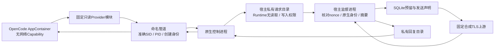

# CimiLoop IPC 宿主网关桥接 v0.1

2026-10-05，V1-09续批，决策D-200。D-198的准确身份命名管道与D-199的宿主HTTPS网关已接通：固定OpenCode 1.18.34在无网络Capability的Windows AppContainer中收到宿主合成HTTPS回复。本批实际Key读取和外部模型请求均为0，TEST预留不代表实际费用，正式Provider受控执行、Task绑定及Agent Run仍未开放。协议保持2.0.0，领域数据库保持8，宿主私有预算账本保持1，没有升级用户库。

## 1. 端到端路径与权限



原生控制进程复用D-198的FIRST_PIPE_INSTANCE、拒绝远程、准确AppContainer SID授权、内核客户端PID与进程创建时间 / 程序路径核验。新`--ipc-gateway`必须使用managed控制和deny_all，不增加internetClient或Loopback豁免。读取请求前仍先验证实际Runtime身份；每操作最多8个唯一请求、32条管道尝试，帧限额收紧为16384字节。

原生进程把已核验帧、原始SHA256、操作键、nonce、Runtime PID和自身PID写入沙箱外的`gateway/requests/`。宿主再核对实际启动的原生进程PID、创建时间、固定程序路径、操作根目录 / 二进制、网络模式、原始帧摘要及固定网关策略；不能根据Runtime标准输出触发HTTPS，也不接受Runtime自行写入的请求文件。实际canary验证AppContainer无法读取或写入宿主文件、也无法向请求目录新增文件。

回复经过私有`gateway/responses/`返回，原生侧核对nonce、操作键、请求ID / 原始摘要和策略摘要，再写回管道。Runtime模块校验完整帧、请求ID / 摘要、合成TEST用量和128的输出上限。Host回复与原来直接生成标记的IPC格式分开；发送后不做连接重试，同ID同输入只重放原回复，冲突输入拒绝。

## 2. 固定策略与模块

新增opencode_gateway_contract_fixture / native_gateway_contract_fixture。连接文件、实际Key、非deny_all网络、任意模型或Provider模块均在声明操作前拒绝；固定模块路径 / SHA256、合成模式、证书摘要及最多8笔的TEST总预算随输入摘要保存。历史操作只核验其原固定记录，不要求与后来更新的内置模块摘要相同；新启动必须匹配当前内置版本。

监督进程在每个独立操作中启动自身合成TLS服务，固定测试域名、路径、模型和输出规则沿用D-199；实际端口 / 策略摘要、证书副本和预算上限在原生启动前保存于宿主私有owner。Runtime配置只有管道地址、操作键、固定本地模块与合成模型，没有API端点、凭据或宿主交接目录。私有目录路径仅交给专门的原生权限canary，真实OpenCode不会收到该canary环境变量。

模块目前只转换system / user / assistant文本消息；工具调用、工具结果和图片等内容拒绝。上游使用完整非流式JSON回复，模块把已经验证的文本转换为AI SDK的流事件；这不是上游SSE或正式工具执行契约。合成标题生成与主回复都是实际经过宿主TLS的请求，分别占用预算。OpenCode显示的cost=0及合成Token计数不作为真实Provider账单或模型Token事实。

## 3. 预留、取消与恢复

宿主沿用D-199独立SQLite账本，BEGIN IMMEDIATE / WAL / FULL先提交预留与发送声明，再发HTTPS；每笔持续占用33408微TEST，实际较小回复不返还差额。预算耗尽在下一次外部发送前拒绝；取消、超时、断流和计费不明保留预留。宿主校验完整响应后才持久保存Completed，Runtime是否实际完成还须核对原生结束与采集证明。

取消文件同时驱动原生Job终止和宿主AbortSignal；原生观察到Runtime结束后再次核对取消 / 输出超限标记，避免宿主Abort返回错误、Runtime先以0退出而误报成功。宿主等待进行中的请求停止后保存预算和上游摘要。原生控制进程崩溃时，Job终止Runtime，监督进程关闭上游请求并保留Unknown预留；不会启动替代进程。宿主监督进程崩溃时，其连接随进程结束，Dispatching预留持续保留，不能因为没有最终回复就重新发送。

`runtime recover`先使用原有准确OS身份核对。任一原宿主、原生控制进程或Runtime仍活跃时，不清理资源、不核对预算。全部原拥有者确认结束后，核验原私有owner / 证书 / 策略，再将未完成Reserved / Dispatching保守转为Unknown；不重启TLS服务，不发送请求，不返还预算。核对另存`gateway-recovery.json`，原运行、原生证明和丢失的宿主完成证明不会被补写为成功。

监督进程退出时原生子进程也可能已经结束，恢复依据实际PID / 创建身份观察，不假设子进程必须存活。故障注入只持有一个经过核验的OS进程句柄，核对创建时间和程序后终止该句柄对应的测试进程，避免另行按PID杀进程造成重用风险。

## 4. CLI与观测

```powershell
pnpm cimiloop --json runtime gateway-bridge-probe `
  --binary '<固定OpenCode原生文件>' --output-dir '<合成桥接目录>'
```

时限可选1000–180000毫秒，默认30000；不接受实际连接、Key、端点或执行策略覆盖。通过退出0，验证失败退出1，参数错误退出2。后续操作沿用`runtime show / collect / cancel / recover`及同一操作键。collect增加原生网关、宿主预算、上游摘要和恢复证明，不采集私有请求帧、SQLite状态或原始消息。

新增RuntimeGatewayTransportObservation、RuntimeGatewayBridgeObservation、RuntimeGatewayBridgeProbeResult三个独立v2 Schema。顶层scope=`synthetic_gateway_bridge_probe`、`ipc_runtime_connected=true`、`cost_known=false`，实际Key读取 / 外部模型请求固定0、正式执行固定false。解析器核对原生与宿主操作键、策略、Runtime PID、预算聚合和完成结果；query还核对原生归属、预算上限、请求摘要链及最终阶段。证明损坏或未完成继续Unknown。

该机器格式不能作为既有真实模型契约探针导入Provider准入；合成回复及TEST上限也不能提升controlled_execution。原RuntimeOperationResult / RuntimeProbeResult、D-198 / D-199机器格式及冻结v1保持。

## 5. 验证及剩余步骤

实际CLI固定OpenCode 1.18.34及SHA256 `5283c2cd5b4285855daa97e6f7d17bf48146227cdf2a940e79e0f2b7869fd06e`，在无网络Capability下完成标题及主回复共2次合成HTTPS请求，留下66816微TEST预留和可归属的会话文本。专项4个测试文件50项通过，新增25项桥接 / 模块 / CLI回归；包含共享IPC旧回归、私有目录权限、重放 / 冲突 / 输出拒绝、预算耗尽、已送达上游后的取消、原生 / 监督进程崩溃、活进程禁止恢复、Unknown保留 / 同键不重启、伪造nonce及证明损坏。Node24.15.0 + pnpm12.4.2下构建、类型检查、Schema同步及全量37个测试文件383项通过（281.73秒），原Runtime机器Schema摘要与冻结v1保持。

另保存9组真实合成桥接验证、140份原始引用及24份固定源摘要；22个保留操作（含早期调试与失败操作）均准确归属回收，详见[IPC宿主网关实测](../research/CimiLoop-IPC宿主网关桥接-2026-10-05.json)。首次专项中的一个恢复断言假设监督进程退出后原生子进程必然存活；实际恢复观察为全部已结束。已改为先验证活进程拒绝，再根据真实OS观察核对结束拥有者，修订后的完整专项通过。持久实测另暴露取消竞态，旧操作曾在Unknown预算已保留时误报Succeeded；旧原始证明保留并明确未通过，修正后新取消操作为Cancelled，新确定性回归及完整测试通过。Windows拥有者在结束过程中可能暂报Unknown，验收只在有界时间内重复准确身份观察，确认全部原拥有者结束才清理，未强制绕过恢复。

下一步为实际Provider建立可核验的计价上界及公网DNS / 固定地址 / 重绑定防护，再做真实网关契约验证；不能将Coding Plan额度折算为零美元或直接采用普通API单价。工具 / 多模态 / 上游流式契约、文件系统硬配额、完整恢复和Task / Agent Run准入仍需分别验收。D-197的host_allowlist和required_cap继续拒绝真实Runtime启动，不因本批合成TEST证明解除。Matt / Superpowers仍按S1的V1-21/22推进，OpenSpec可选，ECC按需参考。

2026-10-05后续D-201已实现固定智谱Coding Plan公网DNS / 一次性地址固定及TLS对端核验，实际两条A / 两条AAAA与所选IP的TLS1.3验证通过；新增有期限的GLM-5.3积分估算及计费缺项查询。公网连接探针的模型端点HTTP、真实Key读取和外部模型请求0，未启动Runtime。积分估算不作为实际费用或准入证明，真实网关计费与正式Task / Agent执行仍未验收。 见[公网网关边界与积分估算](CimiLoop-公网网关边界与积分估算-v0.1.md)。下一步确认专用连接的套餐版本及网关适用环境，建立包含思考Token的输入 / 输出上界、积分与现金预算的明确关系及持久预留，再验收真实HTTPS / Runtime契约；文件系统硬配额与完整受控恢复仍待完成。 本批仅验证连接层，既有真实Runtime host_allowlist / required_cap保持拒绝，Provider受控执行不提升。


D-201复核补充：取消后的回复写入 / 读取排空 / 管道断开竞态已修复。仅在宿主取消标记存在且为具体管道关闭错误时按正常收尾；邮箱 / 身份 / 协议 / 证明失败仍拒绝。新增未读实际回复的原生回归，另8次独立取消实测均为Cancelled且原预算保留，14组定位及修复观察资源确认释放，历史Unknown原始证据保留。见[本批验证与修复](CimiLoop-公网网关边界与积分估算-v0.1.md#4-验证及剩余步骤)。

2026-10-05后续D-202已实现独立持久积分演练账本、共享账户 / 任务累计上限、一次发送凭据、历史回执及原宿主身份核验后的恢复。实际三个独立宿主验证共享上限CAS与发送状态提交后的进程退出；15项CLI检查通过。HTTP、真实Key及模型请求0，真实计费准入与正式Task / Agent仍未启用。 见[持久积分预算与宿主恢复](CimiLoop-持久积分预算与宿主恢复-v0.1.md)。下一步确认套餐版本与网关工具资格，证明服务端输入及思考输出上界，固定实际账户唯一账本、配额 / 账单核对及Task现金 / 积分预算关系，再实现真实HTTPS请求契约；文件系统硬配额和完整受控恢复仍待完成。

后续D-203已实现[固定连接HTTPS传输](CimiLoop-固定连接HTTPS传输-v0.1.md)内部原语及本地TLS / HTTP验证。此前的下一步说明保留为当批记录；现行工作转向实际计费约束、受信宿主协调器、响应缓存与OpenCode工具 / 流式契约，真实准入仍关闭。
