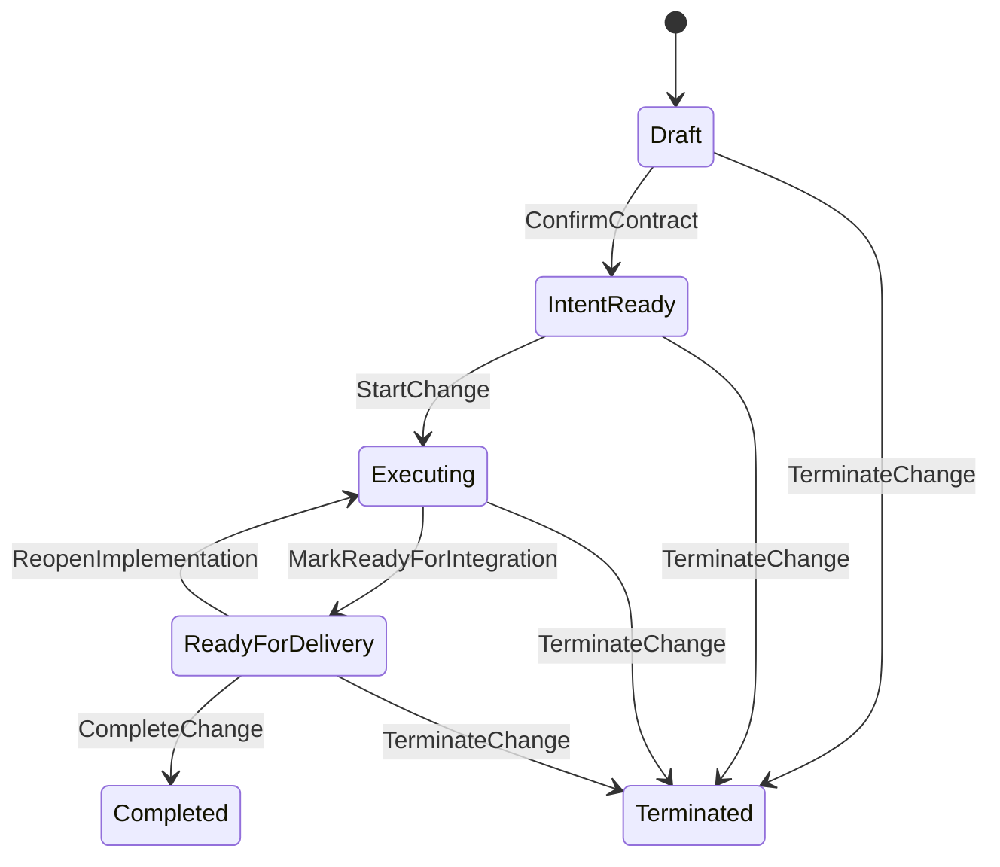

# CimiLoop V1 可执行设计与实施计划 v0.1

> 2026-10-07 D-219 / D-220：真实工作区文件效果、父 Run 结清核验及原暂存资源恢复已实现，本地受信 Human 服务可调用。正式 Agent、IPC / OpenCode、检查命令、费用 / 硬配额及完整 S1 待完成；原生格式 10 / 239 Schema 保持。见[暂存恢复与边界](CimiLoop-工作区暂存资源原始恢复-v0.1.md)。

> 2026-10-07 D-218：公开命名演练的原请求 / HTTP 响应正文账本和实际只读核验已接通；真实模型 / 工具 / 账户保管链、方法宿主及完整 S1 仍待完成。公共来源不能升级受控资格，原生格式 10 保持。见[实现与边界](CimiLoop-命名方法原始会话账本-v0.1.md)。

> 2026-10-07 D-217：独立命名方法资格规则、原始对话 / SDK 效果重放及本地资格准备组合器已实现。真实模型 / 账户 / harness 原账本核验和实际方法宿主尚未接通；读取契约通过不批准正式执行，格式 10 保持。见[实现与边界](CimiLoop-命名方法资格规则与原始效果重放-v0.1.md)。

> 2026-10-07 D-216：技能实际包 / Schema / 输入 / 资料字节准备、完整资源清单及原预约再读已实现，提供原生 prepare 组合接口。没有默认资格核验器或实际效果驱动器，真实资格 / 方法宿主及 S1 仍待完成；Protocol / 格式 10 保持。见[实现与边界](CimiLoop-技能真实输入与宿主准备-v0.1.md)。

> 2026-10-07 D-215：父 Agent Run 下的原生 SkillInvocation 预约、观测 / Human 核对和 CLI / 工作台事实展示已接通；格式 10 布局保持。构造资格不表示真实方法准入，生产宿主及 Plan / Task 创建前的澄清仍待完成。见[调用记录与核对](CimiLoop-SkillInvocation原生记录与核对-v0.1.md)。

> 2026-10-07 D-214：原生Agent Context / Run / 结果固定关系、可信宿主接口及显式格式1–9→10迁移已实现。当前生产Agent宿主与Task批准仍未接通；记录测试使用构造资格，不构成真实受控执行。逐项剩余验收见[Agent上下文与运行固定关系](CimiLoop-Agent上下文与运行固定关系-v0.1.md)。

> 日期：2026-10-02 起草，2026-10-03 收敛，2026-10-07 更新实现状态。
> 工作台续批：D-209 / V1-10人工操作阶段已实现共享应用服务、真实需求 / 版本 / 决定 / 任务 / 交接、本地会话与原请求恢复，见[操作与验证边界](CimiLoop-本地工作台与共享应用服务-v0.1.md)。正式Agent与技能尚未接通，S1完整退出仍待V1-09、21/22及11。
> D-208阶段（历史；真实文件宿主续批见顶部D-219）：D-208已实现原生Human Run实时工具权限查询及独立公开文件执行账本：固定WorkItem / Context / 原操作身份，执行和缓存重放前重新核对授权；公开读取 / 替换保存完成回执，确认原宿主退出后将未dispatch预约归为not_started、已dispatch未完成保留Unknown。四处实际Windows宿主退出和双宿主一槽位争用通过，工具事实不推进原生Task / Run。正式工作区效果、IPC / OpenCode接入该账本及Agent运行仍待验收。 见[WorkItem工具授权与执行账本](CimiLoop-WorkItem工具授权与执行账本-v0.1.md)。下一步建立正式工作区的宿主文件 / 命令能力约束和可验证效果身份，将实时授权与工具账本接入IPC / OpenCode消费，并把工具Unknown纳入原生Run接续核对；继续完成整体受控恢复和物理硬配额。实际套餐 / 工具资格、服务端输入及思考输出上界、受保护的唯一账户Ledger、批准的现金 / 积分预算和账单核对仍待落实。D-208时领域8，D-211增加格式9显式迁移，均未升级用户库；V1-21/22 Matt / Superpowers仍在S1，OpenSpec可选，ECC按需参考。
> 最新技能续批：D-211已接通Skill专用原生证据、评测及固定Runtime的探针Binding，格式9支持显式1–8迁移；三个固定上游包的实际OpenCode加载均保留子进程受限失败证据。真实技能方法、正式Context / Run与V1-22行为对照仍待完成，S1未退出。见[技能证据、评测与Runtime绑定](CimiLoop-技能证据评测与Runtime绑定-v0.1.md)。

> 状态：V1实施基线。V1-01–08已完成本阶段人工实现及联调，D-209 / V1-10本地工作台人工阶段已实现。V1-09正式Task绑定、Agent Run、完整资源 / 费用准入与恢复仍在实施；D-210 / V1-21已接通技能固定来源包装及候选登记，D-211技能探针评测 / Binding已接通，实际调用与V1-22行为对照仍待完成。当前数据库格式10，实际状态及验证范围见第10节。
> 上位流程：[AI Native 软件研发流程](../architecture/AI-Native软件研发流程-v0.1.md)。
> 业务依据：[业务对象与协作闭环设计](../architecture/CimiLoop业务对象与协作闭环设计-v0.1.md)。本文件收敛其候选设计，并取代旧 M1–M5 的直接执行入口；M0 历史事实和已实现能力保留。

## 1. V1 边界与本轮决定

V1 采用本地 SQLite、单仓库项目和 Embedded Solo Mode。主要使用者为推进交付的开发者或技术负责人；本地操作身份是显式初始化的人类 Actor，其角色须单独指派。支持多需求共同发布，先接一个 Agent Runtime、一组测试与生产环境。团队成员外部意见保存可核查来源，不伪造成其本人在系统中的决定。

沿用仓库 TypeScript、Node.js、pnpm、TypeBox/Ajv、Store Port 与 Kernel。首个 Runtime 以 OpenCode 为目标，任务 V1-09 在集成前探测实际接口和锁定 Provider 版本；不满足契约时采用已有备选 Claude Code，并记录适配决定。未通过真实契约验收的 Provider 不进入正式执行，人工记录不能冒充 Runtime 已接通。

| 编号 | 本轮收敛 | 落地结果 |
|---|---|---|
| V1-D1 | 保留 Change 统一需求 / 缺陷身份；需求池与版本页是查询视图 | 不产生第二套需求生命周期 |
| V1-D2 | ReleaseBatch 管过程、ReleaseCandidate 固定内容；内部 Release 管环境授权 | 批次修订不改写候选、批准或历史制品 |
| V1-D3 | 保留 M0 的 Draft 和 operating_status 命名；需求位置精简，等待原因派生 | 不新增可独立写入的 delivery_status 或 flow_condition |
| V1-D4 | Change 管有效 Contract/Plan 指针；版本是不可变记录，Task 是独立执行聚合 | 确认版本与切换指针同事务，不等待跨聚合传播才获得授权 |
| V1-D5 | 项目、需求、任务、批次、授权及环境协调对象分别有 Revision | 不把所有写操作竞争集中到 Project Revision |
| V1-D6 | 环境业务占用与执行租约分开；外部真实状态必须核对 | Lease 超时不能释放环境或证明部署未执行 |
| V1-D7 | 生产验证包括即时检查和必要观察；关闭还检查知识及同步义务 | 生产上线、需求完成和批次结束分别判定 |
| V1-D8 | 采用下文 S1–S4 实施切片；旧 M1–M5 保留为历史，不直接执行 | 开发任务、验证和退出条件共用一个入口 |

首版本地 Actor 表达本机操作者，不构成远程多租户身份认证。Kernel 仍校验角色、作用域和版本；Agent 输入不能自行选择人类身份。要求第二人正式批准时保持阻塞，或使用项目明确允许的受控例外。多人各自登录不是 V1 默认范围。

## 2. 协议约定与事实边界

### 2.1 基本类型与通用字段

| 类型 | 定义 |
|---|---|
| ID | 延续 UUIDv7；旧项目、Actor、Change、Event ID 不重建 |
| Ref | `{ object_type, id, domain_version? }`，需要版本时不可省略；可变对象并发另外使用 Revision |
| Timestamp | UTC ISO 时间；原始观测与接收时间分别保存 |
| Digest | `{ algorithm: "sha256", value }`，完整 64 位十六进制；源码提交引用另标仓库及 Git object format |
| ExternalRef | `{ provider, resource_type, locator, version?, digest? }`；不包含凭据；关键内容必须有版本或摘要 |
| Scope | `{ kind: "project" \| "change" \| "release_batch" \| "environment", id }`；环境授权同时绑定 Environment ID，任务归属只允许前三种 |
| MutableMeta | `schema_version, id, project_id, revision>=1, created_at, updated_at` |
| RecordMeta | `schema_version, id, project_id, created_at, producer_actor_id, source_ref?`；不提供原地更新命令 |

Project 根对象不重复保存指向自己的 project_id；Actor/Role 等项目内对象使用项目作用域。Assignment 保留可选 role_id 供 M0 关联兼容，当前资格按 role_key 与有效 scope 判断。Priority 为非负整数，0 是中性默认值，排序规则由 flow_owner 明确。

对象 Schema 拒绝额外字段。外部执行结果先经 Adapter 规范化，再经协议校验；不能将任意 JSON 当作 Gate 可用事实。Protocol 使用新主版本 `2.0.0`，M0 `1.0.0` 由明确的读兼容与命令转换入口处理。数据库格式使用独立整数版本，与协议版本分开。

V1-01 提供显式 `@cimiloop/protocol/v1`、`/v2` 和版本化读取 / 命令校验入口。根包保留 M0 导出；V1-02 已完成基础 Store、显式 M0 迁移以及 Kernel / CLI 的 v2 切换，旧实现保存在各包 `/v1` 入口用于回归及迁移样本。V1-03 增加可信 Caller、责任治理、设置版本、目标版本、规划排序与容量查询；V1-04 接通真实 Contract / Plan 确认与 StartChange。V1-05 接通固定任务初始化、具体 / 常规授权及累计预算准入。数据库当前格式10，支持显式1–9→10；D-195增加Project作用域Provider证据 / 评测表，D-211增加技能严格分支及种类守卫并冻结格式8来源；D-214增加Agent运行严格分支 / 关系守卫并冻结格式9来源。V1-06 接通真实人工证据 / 专业复核与安全集成；V1-07 接通 Human 运行预约、累计消费、工作区交接及受控恢复。旧成功回执在身份核对后按原摘要重放，新 v1 基础命令经兼容转换及有效 Owner 检查后写 v2。校验能读取其余 v2 状态不等于这些状态已可执行；实际运行、Runtime 和完整策略评价仍在对应任务实现。

代码、完整日志和制品留在 Git、Runtime、CI/CD 或制品库。Kernel 保存引用、摘要、适用条件和结论；证据引用无法访问或无法核对时产生缺口，不能只凭文件名或上传声明通过。

### 2.2 一致性划分

| 主写入聚合 | 同事务保存 | 其他聚合的后续动作 |
|---|---|---|
| Change | 当前指针、版本记录、决定 / Gate、状态变化、Event、Receipt | 初始化任务投影、请求执行、通知关联批次 |
| Task | 当前基准、累计用量、具体授权记录、WorkItem及关联、Event、Outbox、Receipt | 后续运行结果核验与安全集成 |
| WorkItem | 撤销及 Task 清关联同事务；后续预约 / 消费、Run / 交接记录 | 向 Runtime 发起受控执行；结果交给 Task 核验 |
| StandingAuthorization | 当前版本 / 撤销事实、Event、Receipt | 受影响 WorkItem 停止新尝试并核对在途动作 |
| ReleaseBatch | 范围修订、候选记录、选定指针、终止 / 结束事实 | 测试授权、部署、逐条交付核验 |
| Release | 目标与决定、执行预约、撤销和操作记录 | 外部部署 / 核对；环境观测与批次结果求值 |
| EnvironmentCoordination | 当前占用、代次、交接及核对记录 | 拒绝旧代次动作、环境恢复及释放 |

一个命令有一个主聚合；不可变记录可随该主聚合事务追加。跨聚合用幂等内部命令和 Outbox 推进；来源版本与完成检查以事务中读取的最新事实为准，不使用页面缓存决定是否允许动作。少数跨对象资源预约允许在同一 SQLite 事务校验并写协调记录，但不绕过各聚合的业务规则。

## 3. 最小对象字段

表中的字段为 V1 最小集合；`?` 表示可选，进入相应动作时按规则变为必需。版本内容不可改写，修订通过新记录与当前指针表达。

### 3.1 项目、责任与需求

| 对象 | 最小业务字段 | 关键校验 |
|---|---|---|
| Project | 延续 name、repository_kind/path、instance_id；`settings_ref` | 单仓库；项目内 ID 和序号稳定 |
| ProjectSettingsVersion | RecordMeta；`version, predecessor_ref?, settings{wip_limit, flow_owner_actor_id, priority_arbiter_actor_id, priority_order, check_interval_ms, policy_ref?}` | 不可变设置版本与前驱；上限 / 毫秒间隔为正整数；方向higher_first/lower_first；不是Agent并发数。policy_ref核验未接通时拒绝传入 |
| Actor | `actor_type: human/agent/system, display_name, identity_source, provider_identity_ref?` | Source 或 Prompt 不能代替身份；非 human 不可承担最终决定责任 |
| Assignment | `actor_id, role_key, scope, effective_at, expires_at?, ended_at?, granted_by` | 有效期、作用域、授权来源；责任移交连续且唯一 |
| Change | 延续 display_key/title/source；`kind: requirement/bug, lifecycle_state, operating_status, owner_actor_id, requirement_owner_actor_id?, target_version_id?, contract_ref?, plan_ref?, priority, termination_reason?` | 创建可用默认推进负责人；确认约定前必须有验收责任人；目标版本非前置 |
| ChangeRelation | `from_change_id, to_change_id, relation: depends_on/split_from/supersedes/related_to, satisfaction_condition?` | 依赖有可验证条件和阶段；不允许隐式级联状态 |
| TargetVersion | Project MutableMeta；`name, planned_window?{starts_at, ends_at}, status: open/closed, closed_reason?` | 项目内名称唯一；有效UTC窗口；关闭需原因及CAS，不完成需求；归属变更有历史 |
| ContractVersion | RecordMeta；`change_id, version, predecessor_ref?, proposal_ref, content_digest, body{goal, scope, non_goals, constraints, acceptance_criteria[], delivery_endpoint: production_verified, knowledge_impact[], risk, unresolved_questions[]}, risk_ref, confirmation_decision_ref, condition_verification_refs?` | 已实现：交付终点固定生产验证；验收项有稳定 key、场景、预期和证据要求；未解决关键歧义不能确认 |
| PlanVersion | RecordMeta；`change_id, version, contract_ref, predecessor_ref?, proposal_ref, content_digest, body{contract_ref, approach, task_definitions[], dependencies[], verification_strategy}, confirmation_decision_ref, condition_verification_refs?` | 已实现：固定真实当前 Contract；任务 DAG 与跨需求依赖无环；版本与当前指针同事务 |

`owner_actor_id` 管推进，`requirement_owner_actor_id` 管范围、验收和完成，可以同人但不自动代行。规划归属历史与 Relation 为独立记录，由对应 Change 动作创建。已实现的 Contract / Plan 候选包含 RecordMeta、change_id、`proposal_id, proposal_revision, content_digest, base_version_ref: ref/null, predecessor_ref?, body`；链 ID 与每次修订的记录 ID 分开，尚未批准不占正式版本；决定绑定精确记录、修订与摘要。TaskDefinition 嵌入 Plan Body，V1-05 已提取不可变定义记录并初始化持久 Task。

### 3.2 任务、授权与运行

| 对象 | 最小业务字段 | 关键校验 |
|---|---|---|
| TaskDefinition | `task_id, scope, version, purpose: implementation/verification/knowledge/synchronization/release_operation/learning, goal, inputs[], outputs[], dependencies[], allowed_changes[], verification{method, mode: self_check/independent, acceptance_keys[], evidence_requirements[]}, knowledge_keys[], closure_requirement: none/before_release/before_change_complete/before_batch_end, affected_targets[]` | 已实现 Plan 内定义及提取的 TaskDefinitionRecord（RecordMeta、task_id/version/change_id/plan_ref/content_digest/body），同一ID / 版本内容不可改变；需求 Task 已初始化，项目 / 批次任务在 S2 |
| Task | Project MutableMeta；`change_id, scope, definition_ref, contract_ref, plan_ref, status: Pending/InProgress/Satisfied/Cancelled, active_work_item_ref?, active_run_ref?, result_evaluation_ref?, usage{attempts_consumed, attempts_released?, attempt_releases_reversed?, first_started_at?, cost_known, cost_consumed_micros?, cost_reserved_micros?, cost_currency?, pending_reconciliation}` | 已实现需求任务初始化 / CAS、当前基准、累计用量及关联；Ready 派生，V1-06已接通人工满足核验；Human运行预约 / 用量已在V1-07接通，Agent Runtime在V1-09 |
| StandingAuthorization | Project MutableMeta；`scope, current_version_ref, status: Active/Revoked` | 已实现独立 Revision、修订 / 撤销索引，历史版本不可变 |
| StandingAuthorizationVersion | RecordMeta；`authorization_id, version, predecessor_ref?, source_project_revision, grantor_actor_id, policy_assignment_ref, technical_assignment_ref, body{scope, executor_actor_ids[], allowed_actions[], allowed_resources[], environment_ids[], risk_conditions, valid_from, expires_at, limits}` | 已实现 policy_owner 另需技术责任；必须有期限且≤30天、仅普通风险 / 空环境权限；旧版本随修订 / 撤销失效 |
| AuthorizationRevocationRecord | RecordMeta；`authorization_ref, revoked_by, reason, revoked_at, affected_scope, assignment_ref` | 已实现撤销事实及索引同事务保存；外部在途动作另行核对 |
| WorkItem | Project MutableMeta；`task_id, change_id, scope, definition_ref, contract_ref, plan_ref, authorization_basis_refs[1], policy_version: work-item/1.0.0, executor_ref, allowed_actions/resources, budget, inherited_usage, stop_conditions[], independence_required, status: Ready/Active/Closed/Revoked, revoked_at/revocation_reason（撤销必需）` | 已实现需求授权 / 撤销；原始条件固定、用量继承 Task；具体授权记录保存实际 Human、指派及精确内容；Human运行 / Context / workspace 已在 V1-07 接通 |
| RunRecord | RecordMeta及精确Task / WorkItem / 定义 / Contract / Plan；`run_id, run_kind: human, attempt_no, operation_key, context_ref, source_snapshot_ref, workspace_before_ref, executor_ref, reserved_at, input_digest, reserved_cost_micros, cost_currency?, resumption_ref?` | V1-07已实现不可变预约事实；不声称Provider已启动；Agent / Tool在V1-09 |
| RunObservation | `run_id, observed_at, received_at, status: running/succeeded/failed/cancelled/unknown, outputs[], evidence_refs[], usage, external_operation_ref?` | 迟到结果不得回写新基线；终态的冲突观测进入核对 |
| Run | Project MutableMeta；`change_id, task_id, work_item_ref, record_ref, status: Reserved/Running/Succeeded/Failed/Cancelled/Unknown/NotStarted, cancel_requested, reservation_released, release_reversed?, cost_charged_micros, cost_known, latest_observation_ref?` | V1-07已实现Run CAS；来源、原始报告及用量核对后更新；成功不完成Task |
| WorkspaceSnapshot | RecordMeta及精确任务基准；`source_snapshot_ref, head_commit_id, state_digest, manifest_ref` | V1-07保存HEAD、暂存 / 工作区差异、允许范围文件 / 删除及未跟踪字节；读取再次核验内容 |
| ResumptionRecord | RecordMeta及精确任务基准；`handoff_ref, context_ref, source_snapshot_ref, workspace_snapshot_ref, usage_digest, input_digest, budget_remaining` | V1-07核对实际工作区、当前授权、最新交接与累计预算；预约 / 恢复时重查 |
| ContextManifest | RecordMeta及精确Task / WorkItem / 基准；`source_snapshot_ref, workspace_snapshot_ref, executor_ref, boundary, input_refs[5], allowed_actions/resources, input_digest` | V1-07最小原生输入已实现，排除完整执行推理；Provider / 附加材料装配在后续 |
| HandoffRecord | RecordMeta及精确Task / WorkItem / 基准；`source_snapshot_ref, workspace_snapshot_ref, run_ref?, next_actor_ref, completed[], unresolved[], next_action, evidence_refs[], usage_snapshot, budget_remaining` | V1-07已保存真实工作区和用量；接续需原生ResumptionRecord，不自动覆盖文件 |

预算至少有 `max_attempts, max_elapsed_ms, max_cost?`，已实现正安全整数额度；max_cost 使用 `{currency, amount_micros}` 整数微单位。V1-05 持久化 Task 累计用量并检查授权准入，V1-07已接通Human预约 / 消费及返还核对。运行占用尝试额度需原子提交，启动前预约已知成本上限或使用明确费用限制；用量未知时不能宣称剩余费用充足。重启或新会话不重置额度；外部查询 / 状态核对与重新执行区分。定义或权限改变创建新 Work Item，修复仍关联持久 Task。

`max_elapsed_ms` 从持久 Task 第一次 StartRun 预约提交时按经过时间计算，包含排队、等待和进程停机，接续不重新计时；预约但确定未在 Provider 启动的尝试可按核对事实释放次数 / 费用预约，unknown 不能直接返还额度，时间起点不回退。新授权明确承认原 Task 的历史用量，不通过自动重建 WorkItem 绕过已触发的停止条件。

### 3.3 证据、决定与阻塞

| 对象 | 最小业务字段 | 关键校验 |
|---|---|---|
| SourceSnapshot | RecordMeta；`change_id, repository_ref, commit_id, source_digest` | 已实现：可信宿主校验真实完整 Git commit / tree / blob 及源码 SHA-256；目录 / 子模块 Adapter 尚未接通 |
| Evidence | RecordMeta；`change_id, task_id, definition_ref, contract_ref, plan_ref, source_snapshot_ref, work_item_ref, origin: manual_observation, raw_result_ref{provider: local_content, resource_type: manual_evidence, locator, digest}, observed_at, claims[{key, description, result: supports/refutes/inconclusive, observation}]` | 已实现人工路径：内容寻址原始字节 / 严格结构 / 生产者 / 时间 / 适用性核验；运行、制品和环境维度在后续任务增加 |
| Evaluation | RecordMeta及固定需求 / 源码基准；Task分支`purpose: self_check/independent, task_id, definition_ref, work_item_ref, requirement_set_ref, context_ref?, input_digest, evidence_refs[], disposition_refs?, assessments[], outcome, reasons[]`；集成分支`purpose: safe_integration, policy_snapshot_ref, task_evaluation_refs[], evidence_refs[], deferred_checks[], input_digest, professional_decision_ref?, outcome, reasons[]` | 已实现由Kernel读取全部适用证据计算，调用方不能填ALLOW；支持四种结果，反证 / 未知不被后来的支持覆盖；真实Agent独立边界待Run接通 |
| RequirementSetRecord | RecordMeta及固定需求 / 源码基准；`task_id, definition_ref, policy_snapshot_ref, requirements[{key, description}]` | 已实现固定Feature / Bugfix策略派生，覆盖目标、输出、约束、任务及验收证据；Bugfix另含复现 / 回归，独立验证含safe_integration |
| EvaluationContext | RecordMeta及固定需求 / 源码基准；`task_id, definition_ref, work_item_ref, evaluator_actor_id, boundary: manual_independent_read_only, allowed_resources[], requirement_set_ref, input_digest` | 已实现独立Human最小只读交接；不包含实施会话完整推理；不作为Agent会话隔离证明 |
| TaskSatisfactionRecord / IntegrationReadinessRecord | RecordMeta及固定需求 / 源码基准；任务含`task_id, definition_ref, work_item_ref, evaluation_ref, assignment_ref, task_revision`；集成含`evaluation_ref, input_digest, assignment_ref, deferred_checks[], change_revision` | 已实现不可变满足及准入依据；Task CAS关闭授权 / 清关联，Change CAS推进ReadyForDelivery，不完成需求或发布 |
| RiskAssessment | RecordMeta；`change_id, scope, subject_refs[精确Contract候选], input_digest, level: ordinary/high, impact_categories[], rationale, assignment_ref` | 已实现：当前Human技术责任人判断，固定精确候选及摘要；关键影响强制high，不允许自行降低既有high；专业降低风险决定及通用证据关联待后续实现 |
| PolicySnapshot / PolicyVersion | 已实现Snapshot：RecordMeta及固定需求 / 源码基准；`rule_version: verification/1.0.0, profile: Feature/Bugfix, risk_ref`；可配置PolicyVersion尚未实现 | 固定求值版本进入实际需求集；Incident及参数装配留后续，不建设通用规则编程器 |
| DecisionRequest | RecordMeta；`change_id, scope, action: confirm_contract/confirm_plan/verify_decision_conditions/invalidate_evidence/confirm_integration, target_ref, professional_subject_ref?, expected_revision, input_refs[], input_digest, required_role, expires_at, policy_version, risk_ref` | 已实现确认及三种专业复核动作：固定精确候选 / 复核对象、输入摘要与实际职责；策略分别intent-confirmation/1.0.0与professional-review/1.0.0；默认15分钟、最长24小时；请求不是授权 |
| Decision | RecordMeta；`change_id, request_id, target_ref, input_digest, actor_id, acting_role, assignment_ref, choice: approve/request_changes/reject, reason, conditions[], decided_at, review?{raw_result_ref, report}` | 已实现：当前Human身份和独立Assignment有效；高风险分人复核，拒绝不自动取消需求；条件由原批准人逐项核验；专业批准必须附实际原报告，证据失效处置及高风险集成需独立质量职责，否定意见不被旧批准覆盖 |
| LifecycleTransitionRecord | RecordMeta；`change_id, command_id, from_state, to_state, actor_id, acting_role, reason, basis_refs[]` | 已实现 Draft→IntentReady / IntentReady→Executing / Executing→ReadyForDelivery 的不可变依据；既有Pause / Resume记录继续表达运行状态，不混为生命周期迁移 |
| Blocker | `scope, reason_code, source_refs[], responsible_actor_id, resolution_condition, next_check_at, resolved_record_ref?` | 关闭一项阻塞不解除其他阻塞；运行条件从全部未解除原因派生 |

风险与知识影响随 Contract 及独立风险记录引用。V1-04 使用固定 `intent-confirmation/1.0.0` 确认规则并纳入输入摘要，区分普通与高风险，权限、重要数据和关键兼容影响命中高风险检查。high Contract 由风险判断者之外的实际Human批准，high Plan 由提交者之外的实际Human技术复核；无Solo自动豁免。V1-06已实现Feature / Bugfix固定策略快照、人工证据、条件核验、证据失效处置及高风险集成专业决定；Incident和运行 / 环境维度在后续任务接通，不建设通用规则编程器。Agent 可提出风险建议，降低风险须有专业依据，当前尚无降低风险执行入口。

### 3.4 集成、候选、授权与环境

| 对象 | 最小业务字段 | 关键校验 |
|---|---|---|
| SourceSnapshot | `repository_ref, commit_id, git_object_format, source_digest, build_inputs_ref` | 发布来源为确定提交；未提交工作区不可发布 |
| Artifact | `source_snapshot_ref, build_run_ref, digest, external_ref, build_profile_ref` | 摘要完整，来源可复核；构建成功与业务正确性分开 |
| ReleaseBatch | `display_key, mode: normal/emergency, owner_actor_id, planned_change_refs[], planned_window?, selected_candidate_id?, status: Open/Terminated/Closed, termination_record_ref?` | 界面阶段派生；选定候选有 Revision；可以不关联目标版本 |
| ReleaseCandidate | `batch_id, number, baseline_source_ref, source_snapshot_ref, artifact_refs[], membership[], extra_content_refs[], dependency_refs[], formation_evaluation_ref, predecessor_candidate_id?` | 构建核对后形成，不可修改；清单固定 Change、Contract/Plan 和实现来源 |
| Release | `candidate_id, environment_id, conditions_ref, actions[], window, observation_plan_ref, recovery_plan_ref, decision_ref?, policy_ref, status: Proposed/Authorized/Revoked/Expired` | 测试与生产分别授权；生产必须有效 Human 发布决定；候选 / 条件实质变化产生新授权 |
| DeploymentRecord | `release_id, operation_key, occupancy_epoch, action: deploy/recover, requested_at, provider_binding_ref, external_operation_ref?` | 固定一次操作身份；状态由不可变 DeploymentObservation 派生 |
| DeploymentObservation | `deployment_id, observed_at, received_at, status: pending/running/succeeded/failed/unknown/cancelled, actual_conditions_ref?, evidence_refs[], external_result_ref` | 指令成功不代表生产验证通过；实际变化与目标差异保留 |
| Environment | `name, kind: test/production, provider_ref, physical_resource_key, required_capabilities[], policy_ref` | 同一真实资源共享协调边界；定义与实际内容分开 |
| EnvironmentConditions | `config_refs[], flag_refs[], data_schema_ref, migration_refs[], test_data_restore_ref?, dependency_refs[]` | 引用版本不存密钥；测试与生产差异有验证依据 |
| EnvironmentCoordination | `environment_id, epoch, holder_scope?, usage: feature_window/release_validation/emergency/none, status: Free/Held/Switching/Reconciliation, review_at?, restore_manifest_ref?` | 占用代次单调递增；Free 只能通过释放核验取得 |
| ProductionObservationPlan | `required_checks[], failure_criteria[], recovery_triggers[], window_start_condition, minimum_window_ms, completion_conditions[]` | 时长结束不足以通过；实际行为覆盖、监控和观测证据必须满足 |
| ChangeDeliveryAssessment | `change_id, contract_ref, candidate_id, acceptance_refs[], production_evaluation_ref, availability_evidence_refs[], outstanding_task_refs[], evaluation_ref` | 只有符合当前承诺的实际内容可用于完成；决定引用精确核验 |

候选的 membership 每项至少包含 `change_id, contract_ref, plan_ref, implementation_source_refs[], dependency_conditions[]`。以 baseline_source_ref 区分既有内容与本批差异，不要求把整个仓库的历史功能列为本批需求；本批额外脚本、配置、迁移仍有来源和检查。清单不是从目标版本名称推断，无法解释的实际新增内容阻止放行。

生产即时检查、观察检查和需求可用性评价分别保存。环境释放提前于观察结束时，保留观察计划、替代验证环境或已验证重建清单；恢复引用可定位且兼容，不能仅保存旧制品摘要。

### 3.5 Provider 描述与绑定

V1-01提供下列严格Schema；V1-09已接通候选登记、目录和身份检查，并在D-195实现原生Provider证据 / 两类评测及受限探针绑定，详见[证据、评测与受限绑定](CimiLoop-Provider证据评测与受限绑定-v0.1.md)。技术契约ALLOW仅批准isolated_provider_probe；controlled_execution因网络主机 / 费用 / 磁盘 / 崩溃恢复缺口保持NEED_MORE_EVIDENCE。Task绑定、实际权限交集、可信Agent入口及技能调用仍待实施。

| 对象 | 最小字段 | 当前约束 |
|---|---|---|
| CapabilityReference | `capability_id, version` | 能力名称如intent.elicitation，语义版本采用X.Y.Z |
| SchemaReference | `schema_id, digest` | 只绑定可核查Schema，调用包装不得把未知格式当成功输出 |
| PermissionSet | `actions[], resources[], environment_ids[], network_hosts[]` | 描述需求 / 有效权限；实际执行还与WorkItem和本机能力求交集 |
| ProviderDescriptor | RecordMeta；`provider_kind, name, version, source_ref, capabilities[], dependencies[], required_permissions, input_schema_ref, output_schema_ref, trust_status, evaluation_ref?` | 来源版本及完整Digest必需；evaluated须有评价引用；信任变化形成新记录，不修改旧Binding；多能力共用相同输入输出契约，否则分描述 |
| ProviderBinding | RecordMeta；`descriptor_ref, descriptor_digest, capability, resolved_dependencies[], runtime_binding_ref?, input_schema_ref, output_schema_ref, effective_permissions, probe_evidence_refs[], approval?{assignment_ref,evaluation_ref,input_digest,binding_scope}` | 固定来源 / 依赖及原生证据；新批准必须保存approval，旧元数据Binding仍可读。本批只批准探针scope，Task执行拒绝，不改变旧执行依据 |

D-195的原生Provider Evidence分支为RecordMeta及`purpose: provider_probe, descriptor_ref, descriptor_digest, origin: local_probe_observation, raw_result_ref, observed_at`；Evaluation分支为RecordMeta及`purpose: provider_assessment, descriptor_ref, descriptor_digest, profile, rule_version, input_digest, evidence_refs, outcome, reasons, assessments`。公共对象类型仍为evidence / evaluation，Schema及inspect严格区分任务 / Provider，存储分表、专用服务不交叉读取。原始文件、来源及Schema通过可信宿主Port核对实际字节；本机操作者 / 控制端是信任边界，不能把摘要当远程签名或完整权限证明。

Descriptor 的 dependencies 和 Binding 的 resolved_dependencies 每项均为精确 descriptor_ref 与 Digest。SKILL.md 内容不作为可变状态；声明的trust_status和引用必须由有权登记服务确认，不能接受执行Agent自行登记“已评测”。

## 4. 状态、准入与责任

### 4.1 Change 的权威状态

| 状态 | 中文 | 进入动作与最低事实 |
|---|---|---|
| Draft | 待澄清 | CreateChange 创建；不要求目标版本或完整约定 |
| IntentReady | 待实施 | ConfirmContract：需求责任人批准明确约定 |
| Executing | 实施中 | StartChange：计划已确认、开工容量与执行范围满足 |
| ReadyForDelivery | 待交付 | MarkReadyForIntegration：必要自检及独立评价满足，待验证项已交接，安全合入无关键未知 |
| Completed | 已完成 | CompleteChange：本条实际可用、正式验收及生产检查与窗口达标、必要知识 / 同步任务满足，需求负责人确认 |
| Terminated | 已终止 | TerminateChange：取消 / 已拆分 / 被取代，授权、在途动作及副作用处理完成 |

`operating_status` 仅为 Active/Paused。AttentionView 从 Blocker、DecisionRequest、失败及资源状态派生 AwaitingDecision/Blocked/NeedsRecovery 提示，不作为第二个可写状态。Completed 与 Terminated 不可继续创建正式实施 Work Item；后续问题关联新 Change。延期是批次计划与目标版本变化，不是终态。

ReadyForDelivery 发现必须重新实施的缺陷时，`ReopenImplementation` 回到 Executing，并明确受影响任务和证据。Contract 实质变化先阻止旧授权，确认新版本后按影响重新规划 / 评价；不通过变更计划归属机械回退。批准 Plan 只更新有效计划，不新增 Planned 状态。暂停保留生命周期；恢复核对实际事实、容量、全部未解除条件与授权。

### 4.2 派生批次阶段

| 展示 | 事实条件 | 不允许的推断 |
|---|---|---|
| 准备 | Open，无当前有效候选或验证尚未开始 | 计划纳入不等于实际实现 |
| 验证 | 选定候选存在，必要候选 / 环境验收有缺口 | 其他候选通过不能填补当前缺口 |
| 待上线 | 当前候选必要验收满足，尚未满足本次生产交付 | 授权 Proposed 不等于已批准 |
| 生产观察 | 生产实际内容已核对，即时检查通过但窗口未完成 | 计时到点不自动通过，无数据记未知 |
| 收尾 | 当前候选生产验证满足，逐条交付 / 必需义务尚未处理完 | 部署成功不批量完成需求 |
| 已结束 | CloseBatch 提交且本批实际交付核对、必要义务完成 | 原计划中延期项不计实际完成 |
| 已终止 | TerminateBatch 完成外部核对及必要恢复 | 不级联取消需求，不删除失败候选 |

占用转换为 `Free→Held→Switching→Held/Free`；有在途或未知副作用进入 Reconciliation，核实后才允许继续转换。Lease 仅控制当前工作者，不改变业务占用。开始切换就撤销旧 epoch 的执行资格，实际交接须等在途动作停止或完成并核对。

### 4.3 最小责任角色

| role_key | 责任与决定 | 作用域 |
|---|---|---|
| project_owner | 指派和移交责任、维护项目配置 | Project |
| change_owner | 推进、暂停、拆分 / 终止提案及阻塞协调 | Change |
| requirement_owner | Contract、当前候选本条验收、最终完成 | Change |
| technical_owner | Plan、任务定义、风险技术判断和实现回流 | Project / Change / Batch |
| quality_owner | 覆盖与质量结论、专业人员参与依据 | Project / Batch / 相关 Change |
| release_owner | 选定发布候选、生产授权、环境交接 / 释放、终止批次 | Batch / Environment |
| flow_owner | 排序、在制容量和紧急插入安排 | Project |
| policy_owner / exception_owner | 长期规则与有限例外，各自独立决定 | Project 或明确范围 |

产品类 Change 的 requirement_owner 通常由产品承担；技术类按性质指定，涉及产品行为时增加相关产品验收依据。环境恢复负责人是受控任务责任人，不新增长期全权角色。Incident Commander 可协调应急，但不能自动获得其他角色权力。执行命令另允许 acting_role=executor，只表示绑定执行者使用已发布常规授权，不是 Human 责任角色或 Assignment。上述责任可由同人兼任，每次决定仍有 acting_role；高风险要求另一人时不因 Solo 自动豁免。

V1-03 已实现的治理规则及 CLI 见 [责任治理与身份入口](CimiLoop责任治理与身份入口-v0.1.md)。责任角色由 Human 承担；Project Owner 不隐式继承其他角色。非终结 Change 的负责人指派立即生效、持续到明确移交；移交 / 结束的指派快照、实际操作者、原因和依据保存在不可变事件中。登记参与者不等于本人签署或登录，远程认证及真实 Runtime 入口尚未实现。

设置与规划的实际规则见 [项目设置、规划与容量](CimiLoop项目设置规划与容量-v0.1.md)。设置更新需要调用者独立的 Project Owner 与当前指定 Flow Owner 责任；新协调人和裁决人须有持续有效指派。同人兼任不构成两位独立批准人。普通规划由指定协调人处理，排序争议仅由指定裁决人以 Project Owner 身份调整优先级。

## 5. 命令、查询、事件与错误

### 5.1 通用命令处理

Command Envelope 延续 `command_id, correlation_id, command_type, requested_at, source, project_id?, actor_id?, target?, expected_revision?`，新增 `acting_role?, expected_input_digest?`。除初始化外必须解析 Project、实际调用身份与作用域；创建命令不要求不存在对象的 Revision，更新可变目标必须带期望 Revision，提交结果必须带操作或运行 ID 和源版本。

V1 统一以 command_id 为重放键，不另引入语义重复的 idempotency_key。相同 ID 和相同请求摘要返回原 Receipt，相同 ID 不同内容返回 COMMAND_ID_REUSED。成功及已提交的领域拒绝可保存 Receipt；解析错误、瞬时存储失败不保存。旧 M0 成功 Receipt 原样读取；不能对迁移前未保存的拒绝伪造回执。

处理顺序为：解析版本与身份 → 查重放 → 加载目标及最新依赖 → 校验 Revision / 指派 / 条件 → Gate → 同事务保存业务事实、不可变记录、Event、Outbox 和 Receipt。拒绝不创建成功 Transition；需证据或人工决定时保存可解释的 Evaluation / 待办而不伪造推进。

### 5.2 S1 需求与执行命令

下表 Payload 使用第 3 节类型，`refs` 必须精确到要求的版本；命令名在 Schema、CLI 和测试中保持一致。

| 命令 | 主目标与最小 Payload | 条件与结果 |
|---|---|---|
| InitializeProject / CreateChange | 沿用 M0；CreateChange 新增 `kind?, requirement_owner_actor_id?, target_version_id?` | 兼容旧 title-only 调用；默认 kind=requirement，缺验收责任不阻止录入 |
| RegisterActor / EndAssignment | Project；`actor_type, identity_source, provider_identity_ref?, display_name, email?` / `assignment_id, expected_assignment_revision, reason` | 已实现：project_owner 校验严格来源元数据，可信入口另核对实际调用身份；Project CAS，结束另核对 Assignment CAS；责任先移交，不留下空缺 |
| RegisterProvider | Project；`provider_kind, name, version, source_ref, capabilities[], dependencies[], required_permissions, input_schema_ref, output_schema_ref` | 已实现候选登记：Human project_owner，Project CAS；固定candidate / 来源元数据，同类型同名同版本唯一，依赖精确记录摘要；同事务Descriptor / Event / Receipt / Outbox，不评测或授权调用 |
| AssignResponsibility | Project；`actor_id, role_key, scope, effective_at?, expires_at?` | 已实现：project_owner；省略生效时间则立即生效，显式时间不得回溯；授予责任不代替具体决定，不允许有效时间重叠 |
| TransferChangeResponsibility | Change；`role_key: change_owner/requirement_owner, new_actor_id, grant_basis_refs[], reason` | project_owner 及策略规定的交接确认；同事务创建新指派、结束旧责任、更新负责人指针及记录交接，不要求先产生两个有效唯一负责人；已有批准不改署名 |
| UpdateProjectSettings | Project；`base_settings_ref: ref/null, settings` | 已实现：Project CAS与设置基准版本；project_owner另有当前flow_owner指派；追加不可变配置版本并同事务切指针；不得将容量降到当前在制以下 |
| PublishStandingAuthorization / RevokeStandingAuthorization | 首次 Project、随后授权聚合；`base_version_ref: ref/null, body` / `reason` | 已实现 Human policy_owner 另有技术指派；首次核对 Project CAS 不增加其 Revision，后续授权自身 CAS；精确基准 / 作用域 / 期限 / 风险 / 预算 |
| RecordProviderEvidence / EvaluateProvider | Project；`descriptor_ref, descriptor_digest, raw_result_ref` / `descriptor_ref, descriptor_digest, profile, evidence_refs` | 已实现Human project_owner及Project CAS；核对固定来源 / Schema / 原始字节，Kernel计算profile结论；输入不能自报ALLOW，Task证据 / 评价不互用 |
| RegisterProviderBinding | Project；`descriptor_ref, descriptor_digest, evaluation_ref, input_digest, binding_scope, capability, effective_permissions` | 已实现Human project_owner批准探针scope；重算精确技术评测及输入，权限精确匹配声明，同事务记录当前指派及不可变Binding。正式Task执行与DevOps绑定职责、权限交集及控制边界留后续，不能凭探针ALLOW授权运行 |
| RequestDecision / RecordDecision | Change；`action, proposal_ref, professional_subject_ref?, risk_ref?, expires_at?` / `request_id, input_digest, choice, reason, conditions[], raw_review_ref?` | 已实现确认 / 条件 / 证据失效 / 高风险集成动作：Kernel固定输入摘要及所需角色，专业报告核对实际内容；请求和决定只追加事实，不增加Change Revision；记录决定不自动执行目标动作，执行时重新核验 |
| RecordRiskAssessment | Change；`proposal_ref, level, rationale` | 已实现：Human technical_owner；影响来自精确候选，不接受自行降低关键影响或既有high；不使用旧范围评估覆盖新候选 |
| OpenBlocker / ResolveBlocker | 所属 Change / Task / Batch；`reason, sources, responsible_actor_id, resolution_condition, next_check_at` / `blocker_id, resolution_evidence_refs` | 对应责任人提出或核实；解决结论固定依据，不删除原记录 |
| CreateTargetVersion / CloseTargetVersion | Project；`name, planned_window?` / `target_version_id, expected_target_revision, reason` | 已实现：指定flow_owner，Project CAS，关闭另核对目标CAS；关闭不完成或取消需求、不清除已有归属 |
| ChangePlanning | Change；`priority?, target_version_id?: id/null, reason, arbitration?` | 已实现：至少改变一项；指定flow_owner规划，指定裁决人只调整优先级；取消归属明确传null。Change CAS、前后值与原因审计；规划不隐式改变授权与证据 |
| SubmitContractProposal / SubmitPlanProposal | Change；`proposal_id?, expected_proposal_revision?, base_version_ref: ref/null, body` | 已实现：候选链显式CAS修订，保留旧内容；Contract由change_owner提交，Plan由technical_owner提交并固定真实当前Contract；提交增加Change Revision，不授权执行 |
| ConfirmContract / ConfirmPlan | Change；`proposal_ref, decision_request_ref, decision_ref, input_digest` | 已实现：Human requirement_owner / technical_owner重新核验实际批准及当前输入；新增正式版本并同事务切指针；Contract首次Draft→IntentReady，新Contract清除旧Plan指针 |
| StartChange | Change；`plan_ref, opening_reason, emergency_capacity_override?` | 已实现：有效设置与指定flow_owner、CAS、Active IntentReady、真实正式版本 / 决定 / 风险 / DAG / 依赖及事务容量全部满足后进入Executing；超额例外仍拒绝；不创建WorkItem或启动Runtime |
| InitializePlanTasks | Change；`plan_ref` | 已实现 technical_owner、Change CAS、真实正式计划；原子提取定义及初始化 / 受限重新绑定任务，不完成 Task |
| CreateWorkItem | Task；`definition_ref, executor_ref, standing_authorization_ref?, acknowledged_usage_digest?, allowed_actions[], allowed_resources[], budget, stop_conditions[], reason` | 已实现具体 Human 或绑定 executor 命中常规授权；Task CAS、有效开工 / 基准 / 依赖 / 预算；原子关联，不启动 Runtime |
| RevokeWorkItem / CancelRun | WorkItem / Run；`reason` | 已实现授权撤销及取消请求，实际停止须核对；Unknown不能返还预算或放行新运行 |
| PrepareRunContext / ReserveRun | WorkItem / Task；`source_snapshot_ref` / `work_item_ref, context_ref, input_digest, reserved_cost_micros?, resumption_ref?` | V1-07已实现Human上下文及原子预约；Ready授权、真实工作区 / 基准 / 预算齐备后创建Reserved运行，不启动Runtime |
| RecordRunObservation / ReconcileRun | Run；`raw_result_ref` | 原始Human报告固定实际身份、运行键、输入、时间、费用及核对依据；追加原始事实与接收工作区，迟到不替换新活动运行；不完成Task |
| SaveHandoff / CheckResumption | WorkItem；`source_snapshot_ref, next_actor_ref, completed[], unresolved[], next_action, evidence_refs[], run_ref?` / `handoff_ref, context_ref, input_digest` | V1-07已保存原始工作区并核对当前代码 / 授权 / 基准 / 预算；换执行者另需新Human授权；未知先核对 |
| CaptureSourceSnapshot | Change；`commit_id` | 已实现Human技术责任、真实Git源码校验；只追加事实，不增加Change Revision |
| RecordEvidence | Task；`source_snapshot_ref, raw_result_ref` | 已实现绑定Human executor与有效Ready授权、原始字节 / 来源 / 摘要 / 时间校验；不增加Task Revision。真实Run / Batch证据留后续 |
| PrepareTaskEvaluation / EvaluateTask | Task；`source_snapshot_ref` / `requirement_set_ref, context_ref?, input_digest` | 已实现Kernel固定策略需求集及独立Human最小Context，按当前证据计算结果；独立分支必须实际只读Context，Agent / 会话隔离尚未接通；不增加Task Revision |
| SatisfyTask | Task；`evaluation_ref` | 已实现Human技术责任、适用ALLOW与原始内容再次核对、CAS和不可变满足记录；原子关闭WorkItem并清关联；不凭Run succeeded或标签解锁依赖 |
| EvaluateIntegration / MarkReadyForIntegration | Change；`source_snapshot_ref, deferred_checks[]` / `evaluation_ref, input_digest, reason` | 已实现普通 / 高风险人工路径：Kernel生成四种Gate，重新求值及核对HEAD / 干净工作区后Executing→ReadyForDelivery；高风险在必要检查通过后仍需独立quality_owner专业决定，重新求值和应用时核对输入、期限及原报告；不能延期替代safe_integration |
| SubmitEvaluation / RequestIndependentEvaluation | 后续真实Run / Task / Batch评价入口 | 接真实Runtime上下文与原始输出时扩展；当前人工路径不伪造Run |
| ReopenImplementation | Change；`failure_refs[], affected_task_refs[], impact_assessment_ref` | technical_owner；尚未完成且确需重做实施，失效范围明确 |
| PauseChange / ResumeChange | Change；沿用 reason / 空 Payload，补恢复核对依据 | 保留位置；恢复需全部条件满足，未知动作不盲重试 |
| SplitChange | Change；`new_proposals[], source_refs[], disposition_evaluation_ref` | requirement_owner 确认独立结果；未授权新实现，来源终止前核对任务与副作用 |
| TerminateChange | Change；`reason: cancelled/split/superseded, relation_refs[], disposition_evaluation_ref` | change_owner 提案及相应需求判断；取消执行、核对清理后终止 |

V1-05 本地 SQLite 中，Task→WorkItem 创建以 Task 为主 CAS，同事务追加 WorkItem、具体授权（适用时）和关联；没有关联未完成就显示获授权的中间状态。未来拆分存储时才需要幂等请求 / Outbox 协调。Plan 定义随正式版本保存，InitializePlanTasks 在一个 Change CAS 事务中初始化当前计划任务；缺少任务不抹去正式计划事实。创建不是 Run 预约或外部启动。

负责人字段是有效责任指派的当前索引，不能与 Assignment 分别随意修改；责任移交使用上述原子协调，其他角色资格按指派查询。拆分先按唯一请求 ID 建立独立 Draft 和来源关系，确认全部新记录存在后，才允许核对并终止来源；任一创建失败时保留来源可处理，不以 Outbox 已排队冒充拆分完成，也不级联终止新记录。

### 5.3 S2–S4 集成、发布与关闭命令

| 命令 | 主目标与最小 Payload | 条件与结果 |
|---|---|---|
| CreateReleaseBatch / ReviseBatchScope | Project→新 Batch / Batch；`mode, planned_changes, window?, reason` | release_owner；修订计划不修改已存在候选 |
| DefineScopedTask | Project / Batch；`task_definition, confirmation_basis_ref` | technical_owner 或 release_owner 对相应动作确认；无需额外伪造 Change |
| RecordIntegration / RequestBuild | Batch 或项目任务；`source_snapshot_ref, membership_basis_refs[], build_profile_ref` | 真实 Git 结果、N2 必要条件和构建授权；失败保留事实 |
| RecordSourceSnapshot / RecordArtifact | 所属 Change / Batch / Task；`source_snapshot` / `artifact, build_result_ref` | 固定提交及完整摘要，与实际构建来源核对；上传声明不能替代原始证据 |
| FormReleaseCandidate | Batch；`baseline_source_ref, source_snapshot_ref, artifact_refs[], membership, extra_content_refs[], evaluation_ref, predecessor?` | 构建来源 / 实际内容 / 依赖可核查；新增不可变 Candidate |
| SelectReleaseCandidate | Batch；`candidate_id, entry_evaluation_ref, decision_ref` | 同批候选，当前全部必要条件及 N4 准备明确；release_owner 决定，原候选历史保留 |
| RequestAcceptance / RecordAcceptance | Batch 或所属 Change；`candidate_id, contract_ref, evaluation/decision_input` | 分别验证本条验收、产品行为和质量；不使用一个全局勾选 |
| ProposeRelease / AuthorizeRelease | Release；`candidate_id, environment_id, conditions_ref, window, observation_plan_ref, recovery_plan_ref` / `decision_ref?, evaluation_ref` | 测试可命中项目授权，生产必须 release_owner 明确批准；当前候选和条件有效 |
| RequestDeployment | Release；`occupancy_epoch, action, operation_key` | 有效授权、环境占用、最新输入及外部权限；原子预约一次操作并入 Outbox |
| RecordDeploymentObservation / ReconcileDeployment | Release；`deployment_id, observation` / `deployment_id, provider_query_ref` | 查询真实结果；外部超时不能生成第二次未知副作用 |
| DefineEnvironment | Project；`environment_definition, capability_probe_ref, permission_refs` | release_owner 核实实际能力、物理资源和外部权限；不产生虚构环境事实 |
| RecordEnvironmentConditions | EnvironmentCoordination；`epoch, conditions, inspection_refs` | 区分拟用条件和实际观测，不把录入目标当作部署完成 |
| AcquireEnvironment / BeginEnvironmentSwitch | EnvironmentCoordination；`holder_scope, usage, expected_epoch, restore_manifest_ref?, review_at` | release_owner；新代次防旧队列；在途未核实进入 Reconciliation |
| ConfirmEnvironmentSwitch | EnvironmentCoordination；`epoch, actual_conditions_ref, reconciliation_refs[], compatibility_evaluation_ref` | 实际配置数据、恢复与外部操作可核查，才取得 Held 或 Free |
| ReleaseEnvironment | EnvironmentCoordination；`epoch, release_reason, production_evaluation_ref?, termination_ref?, alternative_validation_ref?` | 正常观察通过；未操作生产终止；已操作后恢复；长观察具备替代能力四类条件之一 |
| EvaluateProduction | Release；`deployment_id, check_evidence_refs[], observation_evidence_refs[]` | 内容一致、即时及约定窗口全部满足；不足保留观察 / 缺口 |
| RequestRecovery | Release；`failure_refs[], recovery_action, recovery_basis_ref` | 预授权范围内可执行，超界需新决定；恢复后检查结果另存 |
| AssessChangeDelivery / CompleteChange | Change；`candidate_id, contract_ref, evidence_refs[]` / `assessment_ref, decision_input` | 当前范围实际可用，验收、生产验证、知识与同步义务满足；Complete 由 requirement_owner |
| TerminateBatch / CloseBatch | Batch；`disposition_evaluation_ref, decision_input` / `closure_evaluation_ref` | 核对在途动作、生产和遗留；Close 不批量修改 Change |

修复、剔除和同步复用 Task、WorkItem、SourceSnapshot 与 FormReleaseCandidate；无需通用“修改候选”命令。替换候选后重新检查所有拟执行动作。Normal 批次来源遵循 feature 快照；Emergency 必须有生产来源核对及技术、发布责任决定，允许先上线，同步义务进入 H 的 Plan 和受影响批次发布检查。

### 5.4 结果、事件与查询

v2 成功结果新增 `schema_version, command_type`，延续 `ok, command_id, correlation_id, aggregate, revision, events, data`；`data` 与command_type配对为严格Union，不使用无类型任意对象。DomainError 增加schema_version并使用已登记稳定code，延续category/retryable/details/correlation_id。v1无版本字段的历史成功 / 错误仅按原Schema读取，不为其补造标记；Gate四结果单独在Evaluation中表达，禁止假造成功迁移。

事件使用既有 Envelope 扩展对象类型，事件 Payload 含变化后的精确引用和因果关系。最小类型包括 ChangeCreated、ContractConfirmed、PlanConfirmed、ChangeStarted、WorkItemCreated、RunObserved、TaskSatisfied、ChangeReadyForIntegration、CandidateFormed、CandidateSelected、ReleaseAuthorized、DeploymentObserved、EnvironmentSwitched、ProductionEvaluated、ChangeCompleted、BatchTerminated / BatchClosed。历史 M0 event_type 不改名。

查询至少提供 `GetProjectWorkbench, ListChanges, GetChangeDetail, GetTaskDetail, GetWorkItemDetail, GetReleaseBatch, GetCandidateComparison, GetEnvironmentOverview, GetDecisionInbox, GetTimeline, GetFlowMetrics`。每个视图返回 `as_of_event_sequence`、原始事实引用及可执行动作 / 未满足条件；查询可以重建，不能作为写入授权依据。

### 5.5 稳定错误与恢复语义

| code | 分类 / 可重试 | 调用者应如何处理 |
|---|---|---|
| PROTOCOL_VALIDATION_FAILED / UNSUPPORTED_SCHEMA_VERSION | validation / 否 | 修正请求或使用明确兼容入口 |
| COMMAND_ID_REUSED / REVISION_CONFLICT | conflict / 否 | 不能原请求盲重试；刷新事实，审查后使用新 command_id |
| ROLE_NOT_ASSIGNED / AUTHORIZATION_EXPIRED / AUTHORIZATION_REVOKED | forbidden / 否 | 取得有效指派或授权，不由 Agent 改身份 |
| INPUT_CHANGED / DECISION_STALE | conflict / 否 | 基于新对象版本重新求值或决定 |
| WIP_LIMIT_EXCEEDED / DEPENDENCY_UNSATISFIED | conflict / 否 | 先处理容量 / 依赖；紧急例外须有记录 |
| EVIDENCE_MISSING / INDEPENDENCE_REQUIRED | validation / 否 | 补对应证据或独立评价，未知不改为通过 |
| BUDGET_EXCEEDED / BASELINE_MISMATCH | conflict / 否 | 停止受影响执行，确认预算或核对接续差异 |
| ENVIRONMENT_BUSY / OCCUPANCY_EPOCH_MISMATCH | conflict / 否 | 等待或重做环境交接；旧操作不得续写 |
| EXTERNAL_RESULT_UNKNOWN / EXTERNAL_STATE_STALE | conflict / 否 | 查询实际状态；状态核对可重试，部署本身不盲重试 |
| CAPABILITY_UNAVAILABLE / CAPABILITY_PERMISSION_DENIED / PROVIDER_NOT_EVALUATED / PROVIDER_BINDING_STALE / PROVIDER_OUTPUT_INVALID | validation或forbidden/conflict，依原因 / 否 | 核对实际能力、权限、来源版本及输出契约；不静默换Provider或放宽格式 |
| RECOVERY_CONDITIONS_UNMET / CLOSURE_OBLIGATIONS_PENDING | conflict / 否 | 恢复兼容条件或完成必要义务 |
| STORE_FAILURE | storage / 是 | 无已提交副作用时可用同 command_id 重试；存在疑问先查 Receipt |
| MIGRATION_REQUIRED / MIGRATION_UNSAFE / DATABASE_TOO_NEW | storage / 否 | 显式升级或改用对应版本程序，不写未知格式 |

错误 details 给出对象引用、缺项、当前 Revision、责任人或接续动作；不输出凭据。可重试表示相同请求在无新业务决定时能安全再次提交，不能因外部 HTTP 超时就给部署命令标为可重试。

## 6. Runtime、DevOps 与本地工作台接口

### 6.1 最小执行契约

Runtime Adapter 实现 `probe(binding), start(work_item, context, operation_key), query(operation_key), cancel(operation_key), collect(operation_key)`，返回协议化 ProviderResult，包含绑定版本、外部操作身份、实际状态、产物 / 原始结果引用及可取得用量。Probe 明确身份隔离、工作区、权限限制、取消、恢复查询和事件采集能力；不足时形成明确限制或不允许对应动作。

Start 前 WorkItem 与运行预约已提交；Provider operation_key 对应稳定操作。若 Provider 不支持幂等 Start，进程和 Session 标识须可重新查询；查询无法排除已启动时进入核对，不能盲开第二个会话。自主运行仅获 WorkItem 的最小目录、命令和环境能力；权威库和人类批准入口不得作为执行者可随意写入资源。

人类与 Agent 的命令入口分离调用上下文：Agent Gateway 绑定 agent Actor，不接受 Payload 自报 human；Human CLI / 决策页绑定本地操作者。界面可以由 Agent 提出决定请求，但不能由执行中的 Agent 调用人类批准通道。该隔离不是远程认证方案，首版应记录本地信任边界和实际可保证能力。

隔离由本地应用服务及实际执行权限落实，不能只靠 CLI 参数或 Prompt。Runtime 在独立受限身份或可验证沙箱中执行，无法直接改写权威库、读取人类会话凭据或调用人类决定入口；V1-09 必须验证这些边界。Provider 自身的提示词限制不算权限证据，不能保证时阻止对应自主动作并记录缺口。

### 6.2 DevOps 与环境契约

环境 Adapter 实现 `describe, inspect, deploy, query, cancel?, recover, verify_conditions`。输入固定 Release、Candidate 摘要、环境条件和 epoch；返回 External Operation 身份与观测引用。

Provider 必须支持执行前 epoch 校验或等效串行隔离；无法保证时阻止共享环境自动部署并要求有权人员在实际执行边界协调。开始切换时既校验排队操作，也核对已经发出的操作；取消请求不等于实际已取消。跨项目共享物理资源按 physical_resource_key 协调，首版无法协调则明确阻塞，不能每个本地库各自宣称独占。

ObservationPlan 中每项检查有场景 key、预期、证据来源及有效时间；窗口以确认部署及指定行为开始条件计时。定时任务尚未发生、监控缺失或数据未知时保持待观察。失败依据 RecoveryPlan 判断是否可执行恢复，超出数据 / 权限 / 内容边界生成新决定请求。

### 6.3 共用 Kernel 的最小 UI

新增独立 `apps/workbench`，提供本地服务端与六个入口：项目工作台、需求池与版本、需求详情、发布批次、环境概览和决定收件箱；执行详情从需求或批次任务下钻。S1 先完成需求、任务和决定相关页面，S2/S3 接续发布与环境页面。首版 Node 本地服务只绑定回环地址、使用本地会话凭据及请求来源 / 写操作防伪校验；不开放可从任意网站或网络发起的人类决定入口。凭据不进入页面日志、Agent 上下文或事件。

UI 通过共享应用服务调用 Kernel，CLI 与 UI 不复制业务规则。现有 `apps/demo-web` 保持演示定位，不以其 reducer 或固定数据作为正式事实源。候选对比展示实际清单、来源差异、证据复用及缺口；需求页面引用共享决定，批准时展示整个批次。环境同时显示目标内容、最后实际观测、占用与恢复条件。

## 7. Store、M0 兼容与迁移

### 7.1 数据存储布局

继续使用已有 SQLite 权威库与项目对象目录。逐切片增加具名实体表 / 版本记录表；可采用结构索引列与严格校验的 payload_json，索引只加在实际查询及唯一性要求上。至少保证 `task_id`、`batch_id+candidate_number`、`release_id+operation_key`、`environment_id+epoch`、域版本身份和 Event Sequence 唯一。

StoreTransaction 增加类型化读取、追加不可变记录、CAS 更新和查询 Port；不开放任意对象 setStatus 或任意 SQL 给 Kernel。Protocol 从 TypeBox 导出 JSON Schema 并同步制品；消费者通过同一 Schema 验证命令、结果和存储记录。

当前 M0 Outbox 与 event_id 一对一。新设计增加 `effect_key`、`kind` 和可核查目标引用，唯一性改为 `(event_id, effect_key)`，支持一次事实推进多个需求及外部动作。旧消息迁移为 `effect_key=legacy`、`kind=legacy_event_delivery`，保留 delivered 状态，不把已投递通知误作待执行部署。业务占用、操作身份和累计预算是持久事实，运行租约仍是可恢复协调状态。

### 7.2 升级流程

V1-02已实现MigrationRunner；V1-03–07逐批增加规划、确认、任务 / 授权、验证及运行 / 交接表，D-195增加独立Provider评测表。当前store-sqlite先读取格式，新项目创建8，旧格式1–7返回MIGRATION_REQUIRED，不静默变更，太新格式拒绝写入。显式migrate --check / migrate核对冻结布局及实际原子历史，逐格式验证设置 / 规划、确认 / 生命周期、任务 / 授权、专业验证、运行 / 用量 / 取消 / 交接及候选Provider登记。已有对象、回执和事件原样保留，不补造满足、运行成功或Provider批准。操作见[数据库迁移与恢复](CimiLoop-M0数据库迁移与恢复-v0.1.md)。

1. 调用方先停止外部写入者和投递 Worker；迁移独占文件锁并持有 SQLite 写事务，拒绝现存写事务或有效 Outbox 租约。当前没有自动管理外部 Worker 的服务，写锁也不能证明外部动作已结束。M0 无执行 Adapter，保留其 Outbox 历史。
2. 在无权威写入时使用 SQLite 一致性备份 API 或等效检查点备份，包含必要 WAL 与内容目录清单；不能直接复制活动 project.db 当作完整备份。
3. 校验 M0 全部对象、索引、事件序列、外键、Receipt 及 Outbox；遇到非 M0 的 lifecycle_state 或未知协议数据拒绝猜测迁移。
4. 同事务执行有序版本迁移：保留 ID、display_key、owner、Draft、Active/Paused、pause_reason；新增 kind=requirement、priority 默认中性值，requirement_owner_actor_id 暂空，等待真实指派；不自动伪造 Contract、验收、角色批准或发布候选。
5. 保留历史 Event、Transition、成功 Receipt 的原始 `schema_version=1.0.0` 与内容。Current State 转新格式并记录迁移来源及新 Event；旧事件通过版本化读取投影，不原地改写其摘要。ProjectCounter 不重置。
6. 追加新格式标记、运行完整性检查，生成迁移报告和备份引用，再恢复调度。中途失败回滚数据库事务；未提交格式标记时原程序仍读原格式。

ProjectSettings 由已实现的显式配置命令生成，不在迁移时代替用户批准容量和角色。历史 CreateChange / PauseChange / ResumeChange 的同 command_id 重放先返回原 Receipt；未处理的新 1.0.0 命令通过兼容转换，保持 title-only 默认与Draft暂停恢复语义，同时遵循新授权检查。历史结果仍用旧 Schema 验证，不为让输出适配新形状重新执行命令。

### 7.3 回退与未覆盖格式

格式升级后旧 M0 程序不得写新库。新程序尚未执行新业务或外部副作用时，可停写恢复迁移前一致性备份；产生新业务事实后回退需保存新事实并评估外部影响，不支持自动降级删除历史。未来 Solo→Team 保留稳定身份与同一协议，在只读封存旧实例后切换单一写权威；组织账号与 Team 导入实现可延后，但相关引用不得设计为本地目录主键。

## 8. 可直接实施的任务顺序

各任务开始前读取其依赖、本文和对应专项当前规则。优先复用现有模块，不把执行细节再次变成宏观设计讨论。完成一项必须交付实现、原始检查结果、已知缺口及必要文档；任务之间的接口变化先同步下游。

### 8.1 S1：需求与执行闭环

目标：真实普通修改从录入、澄清、计划、人或 AI 实施、自检、独立评价走到 ReadyForDelivery，并在中断 / 重启后接续。不把模拟 Provider 的测试通过当作真实 Runtime 已接通。

| 任务 | 依赖 | 修改范围与具体工作 | 验收条件 |
|---|---|---|---|
| V1-01 Protocol v2 与基础结果 | 无 | `packages/protocol`：通用类型、Change 状态、Actor/Assignment、基础命令及结果 Union、稳定错误、Provider Descriptor/Binding；v1/v2入口与版本化校验；分别导出Schema | v1 原记录和结果可读；额外字段及未知版本被拒；已支持对象均注册；v1制品不改写；现有M0回归通过。Contract/Plan等域Schema在所属任务补齐 |
| V1-02 MigrationRunner 与扩展 Store | V1-01 | `packages/store`、`store-sqlite`：版本读取、check/backup/apply、Current State 与历史读兼容、Outbox effect_key、Receipt 类型扩展 | 真 M0 数据库无损升级；中断回滚；v1 Receipt 重放原结果；数据库太新不写；无伪造验收身份 |
| V1-03 责任、设置与开工容量 | V1-02 | Kernel 治理命令、有效指派和移交、项目设置、排序、在制查询、StartChange 原子容量检查 | 同时开工不会突破容量；等待任务计在制；Agent不能自报 human；同人兼任有独立角色依据 |
| V1-04 Contract / Plan 与确认 | V1-03 | Protocol、Kernel、Store：候选修订、精确决定、风险与知识影响、正式版本、DAG验证 | 过期批准拒绝；Plan绑定当前Contract；环和缺关键验收拒绝；指针与确认Event同事务 |
| V1-05 Task 与 WorkItem | V1-04 | 固定任务定义、运行任务初始化、常规授权命中、修复授权和预算 | 有效常规授权不重复人工确认；边界变化新WorkItem；Run状态不完成Task |
| V1-06 Evidence / Evaluation 与安全集成 | V1-05 | 自检、独立评价、适用性、四种Gate、待验证交接、MarkReadyForIntegration | 原执行会话自检不满足独立评价；必要失败阻断；关闭义务可留待后续但安全合入未知不能推迟 |
| V1-07 运行与交接恢复 | V1-05 | WorkItem运行预约、RunObservation、Context/Handoff、剩余预算、接续核对及外部unknown处理 | 换会话不丢基线、修改与预算；迟到结果不改新基线；未知副作用先查询 |
| V1-08 CLI 完整动作与查询 | V1-03–07 | `apps/cli`：需求、责任、方案、任务、执行、评价、交接与迁移入口；共享Kernel应用服务 | 文本与JSON走同一命令；所有机器输出过Schema；冲突显示当前事实及缺项 |
| V1-09 Runtime 探针与首个Adapter | V1-05、07 | 新增 `packages/runtime-adapter`；按§6.1探测目标OpenCode实际安装接口，保存版本 / probe结果，再实现start/query/cancel/collect和执行权限隔离 | 一个真实Runtime完成修改、原始结果采集与独立评价会话；A9权限边界成立；响应丢失不重复启动；若需切换Claude Code先记录契约差异 |
| V1-10 本地Workbench | V1-08，正式执行依赖V1-09 | 新增 `apps/workbench`：本地服务、工作台、需求池与版本、需求和执行详情、决定与交接；复用应用服务 | 写入口有本地会话和来源校验；没有另一套业务状态；实际任务可从页面或CLI接续 |
| V1-11 S1 场景与回归 | V1-06–10、V1-21–22 | 跨模块测试、Store契约、真实Runtime与技能记录及M0回归；补说明和限制 | A1–A5的S1部分、A9、F1–F3及R1–R6的S1部分通过；保存一次含真实技能调用的普通修改全链路证据，到ReadyForDelivery为止 |

V1-09 的先行探针可以在 V1-01 期间进行只读与隔离验证，不依赖已完成全部内核。正式 Provider 绑定只在对应 Schema 和授权边界完成后集成。TaskDefinition 可以包含后续知识义务；N2 Gate 检查本阶段必需实施与验证任务，以及延期验证安排，不要求先完成所有发布或关闭任务。

#### S1 补充：方法框架与 Skill Provider

补充任务保留原V1-01–20 ID；按依赖执行，V1-21/22必须在V1-11的S1退出验收前完成，不能按数字递增跳过。V1-23为可选试点，未启用不阻塞V1。技能方法用于产生提案、实现或评价；任务、正式基线、权限及Gate仍由Kernel管理。

| 任务 | 依赖 | 工作 | 验收条件 |
|---|---|---|---|
| V1-21 Skill Provider 包装与调用契约 | V1-05、07 | 定义版本化能力标识、来源commit与内容Digest、运行依赖、权限需求、输入输出Schema引用、信任状态、评测依据；包装SKILL.md，Context/Run固定ProviderBinding；候选登记走RegisterProvider，评测准入后的绑定与升级走RegisterProviderBinding | 来源可追溯，组合技能依赖完整；权限不足阻断；输出严格验证后形成候选/证据；不能自动确认Contract、完成Task或批准Gate |
| V1-22 Matt与Superpowers受控试点 | V1-06、09、21 | 以Matt为首批候选，打通需求澄清和独立评审两种能力；对重叠诊断/TDD/验证能力选择一项Superpowers做对照，按场景确定默认Provider | 固定真实来源与版本；代表性场景有原始评测；无增益的Superpowers保持可选；不启用全局bootstrap，不建立第二套任务权威；真实调用结果进入CimiLoop记录 |
| V1-23 OpenSpec可选Spec Adapter | V1-04、21；启用前记录收益与范围 | 原生Contract/Plan先成立，再试点规格读取、受控输出、delta检查及长期行为规格更新；外部ID和版本保留 | F4通过；OpenSpec任务完成或archive不关闭Change，不用文件存在证明Gate；未启用时原生路径可完整执行 |

V1-03 内部按责任治理、设置 / 规划 / 容量两部分推进，不增加任务总数。StartChange 的容量检查在 V1-03 建立，V1-04 已以真实 Contract / Plan 确认及依赖验证完成正向联调和双进程竞争验收；没有确认依据时保持拒绝，早期低层夹具不作为业务确认事实。执行中恢复仍等待实际Task / WorkItem与在途动作核对，不用开工成功冒充Runtime已接通。

ECC 在 V1 作为方法来源：上下文、Hooks、权限与学习边界在 V1-07、09、19、21 中按需要参考，记录具体采用内容、来源和验证；不安装整套ECC或新增常驻编排层。代码或技能实际复用时核查固定来源及许可，单纯借鉴模式与运行依赖分别记录。Matt、Superpowers及OpenSpec的当前接口与能力在适配时探测，不把历史调研当作最新兼容保证。

### 8.2 S2：多需求候选

| 任务 | 依赖 | 工作 | 验收条件 |
|---|---|---|---|
| V1-12 批次、项目任务与构建来源 | S1 | Batch/ScopedTask、Git实际结果与快照、构建授权、制品Manifest | 不伪造需求组织共同任务；构建失败不形成完整候选 |
| V1-13 不可变候选与依赖 | V1-12 | 基线差异、实际membership、依赖满足条件、Form/Select、候选对比 | 至少两需求共用制品；额外内容可追溯；未指定目标版本仍可纳入 |
| V1-14 当前候选验收与延期 | V1-13 | 逐条验收、范围修订、实际剔除工作、证据适用性和新决定 | B1–B4通过；依赖失败同时检查受影响需求；旧候选批准不可用在新候选 |

### 8.3 S3：环境与生产交付

| 任务 | 依赖 | 工作 | 验收条件 |
|---|---|---|---|
| V1-15 环境协调与能力探针 | S2 | 物理资源key、占用epoch、恢复Manifest、在途核对；DevOps契约实现 | 旧队列不能覆盖；不兼容数据阻止简单换包；无法确保互斥时明确阻塞 |
| V1-16 Release 与部署 / 核对 | V1-15 | 测试/生产分别授权、一次操作身份、观测历史、恢复权限 | 未获生产授权不能部署；超时/丢响应先query；同摘要晋升，条件差异可解释 |
| V1-17 生产观察与交付关闭 | V1-16 | 即时检查、窗口证据、提前释放条件、逐条Assessment与Complete、BatchClose | A6–A8及E1–E4通过；观察未完或知识未达标不能完成，环境可提前释放但不改生产结论 |

### 8.4 S4：紧急路径、收尾与完整验证

| 任务 | 依赖 | 工作 | 验收条件 |
|---|---|---|---|
| V1-18 生产基线紧急修复与同步 | S3 | Emergency来源核对、环境抢占和下一批暂停恢复、等效修复同步任务 | C1–C4通过；无需先适配feature但下一批不能丢修复 |
| V1-19 导出、知识与最小度量 | V1-17–18 | 导出协议事实和来源清单；复用 S1 已有知识任务与 S3 关闭检查，补知识来源接入及查询；周期、等待区间并集、返工、人时及可取费用 | 稳定ID与历史保留；未知不填零；暂停/延期/终止样本保留 |
| V1-20 V1 全闭环验收 | V1-19；S1已含V1-21–22 | 三场景、异常注入、真实Runtime与技能、测试/低风险目标环境；操作指南 | 全部必选验收满足并留证；启用OpenSpec时加F4；失败可恢复，无未声明的手动步骤或能力缺口 |

## 9. 验收矩阵与验证方法

每个编号落实为具体验收场景，记录输入、注入事件、命令、预期事实及原始证据。纯规则用单元 / 契约测试，外部操作用可控 Provider 注入故障并在低风险实际环境复验；不把Mock结果替代真实集成结果。

| 编号 | 场景 | 必须成立的结果 | 最早切片 |
|---|---|---|---|
| A1 | title-only录入，无目标版本 | 创建同一Draft；确认约定前补责任与验收 | S1 |
| A2 | 暂停后他人改接口，另一会话接续 | 识别实际差异，不覆盖修改、不直接继承旧结论 | S1 |
| A3 | 原执行者“再自查”，或缺独立原始依据 | 只能自检；独立准入不通过 | S1 |
| A4 | 候选或约定改变后提交旧决定 | DECISION_STALE/INPUT_CHANGED，历史决定保留 | S1 约定 / S2 候选 |
| A5 | 两客户端争最后WIP名额 / 同授权重复运行 | 原子容量与预算预约，最多允许有效名额和尝试数 | S1 |
| A6 | 两需求共用候选测试与生产 | 一次共享部署，各自验收与完成，不复制批准 | S3 |
| A7 | 部署即时检查通过，定时任务尚未发生 | 生产观察未通过，需求未完成 | S3 |
| A8 | 已实际可用但必要知识任务未完成 | ReadyForDelivery并显示待收尾，Complete拒绝 | S3 |
| A9 | Agent伪造human身份、调用人类CLI或尝试改权威库 | 真实权限与调用上下文拒绝；不是仅由Prompt阻止 | S1 |
| B1 | A依赖B，B失败需延期 | 明确A同受影响，不能只取消B清单继续发布A | S2 |
| B2 | C1剔除实现后形成C2 | 内容真实改变、重建 / 必要回归，C1及旧批准不覆盖C2 | S2 |
| B3 | 无法安全剔除 | 保留问题或终止批次，不强行发布独立项 | S2 |
| B4 | 仅调整目标版本 | 不制造新需求、不静默改变Contract或全部证据有效性 | S1 / S2 |
| C1 | feature已重构，生产基线需紧急修复 | Emergency候选来自实际生产来源，不包含未发布feature内容 | S4 |
| C2 | 下一批数据库不兼容旧代码 | 安全恢复或隔离验证；没有恢复依据不能切换 | S4 |
| C3 | 紧急修复上线，但feature/下一批未同步 | 生产结果独立保存，H关闭和受影响下一批上线检查同步义务 | S4 |
| C4 | 下一批恢复并采用等效修复 | 新候选或适用性证明、故障回归及必要重验，不机械要求相同提交 | S4 |
| E1 | feature部署已排队或在途，切换release占用 | 旧epoch不能执行；已发操作query/cancel确认后才交接 | S3 |
| E2 | 未操作生产即取消发布 | 核实未影响生产即可终止交接，不伪造恢复 | S3 |
| E3 | 长观察且已验证替代环境 / 重建 | 可获准释放共享环境；生产仍观察，复验能力可用 | S3 |
| E4 | 外部超时、窗口已到但缺监控、恢复结果未知 | 保留未知，先核对，不完成、不盲重试 | S3 |
| R1 | 写入Event或Outbox中途失败 | 状态、事件、Receipt同时回滚，无半提交 | S1 |
| R2 | 命令响应丢失，再提交同ID | 原Receipt重放，无重复版本/任务/副作用 | S1 |
| R3 | 两客户端更新同Revision | 一方成功另一方冲突，不能后写覆盖 | S1 |
| R4 | 运行、Outbox和部署时重启 | 业务事实保留，过期租约重建，未知外部动作先核对 | S1 / S3 |
| R5 | M0库升级失败或新程序试图写未知格式 | 完整事务回滚 / 拒绝写入；备份可恢复 | S1 |
| R6 | M0成功命令与旧Schema事件读取重放 | ID、序列、历史摘要和原结果保留；不重新执行 | S1 |
| R7 | 逐条交付传播一半时崩溃 | 重启幂等补齐，不完成未达标需求，不重复发布 | S3 |
| F1 | 技能内容、依赖或权限在执行期间改变 | 原Binding保留；摘要变化或越权阻断新调用，不静默换技能 | S1 |
| F2 | 技能输出缺字段、额外字段或自报通过 | 输出校验拒绝；不能直接写正式基线、Task完成或Gate | S1 |
| F3 | Matt/Superpowers对照及独立评价 | 同Capability默认选择有评测依据；评价Context隔离；真实输出可复查 | S1 |
| F4 | OpenSpec任务全完成或archive | 仅保存外部产物事实；Change仍按Kernel验收和关闭 | 可选V1-23 |

验证命令沿用仓库当前脚本：`npx pnpm@12.4.2 check`、`npx pnpm@12.4.2 test`、`npx pnpm@12.4.2 build`。新增 / 修改Schema后运行schema:export并检查制品同步。每个任务只运行相关验证和受影响回归，切片退出再运行完整检查；已完成任务的实际验证见下表，不把全局流程验收视为已经通过。

## 10. 文档、实现入口与完成判定

本文是 V1 当前字段、命令、状态、错误、兼容与实施任务的统一入口；流程基线约束业务，专项架构解释各域当前职责，历史正文单独标明。变更本实施基线时同步涉及的专项当前规则、Protocol、验收编号和操作说明，账本记录原因及替代关系。

| 实施项 | 当前状态 | 实际证据及限制 |
|---|---|---|
| V1-01 | 已完成（2026-10-03） | v1/v2显式入口、基础对象及命令 / 结果、版本读取、Provider元数据和Schema制品；当时7个测试文件34项及两个包子路径导入通过。Contract/Plan域Schema留给对应任务；消费者随后在V1-02切换 |
| V1-02 | 已完成（2026-10-03） | 格式2 Store、只读预检查、一致性WAL备份与内容清单、原子迁移、历史读取 / 原回执重放、多效果Outbox和租约校验；基础Kernel / CLI执行v2。真实M0样本、四处异常回滚、两处实际进程退出、CLI升级、CAS及读快照均已验证；Node24.15.0 + pnpm12.4.2下构建、类型检查、Schema同步及全部9个测试文件57项通过。仅迁移临时样本，完整授权仍属V1-03 |
| V1-03 | 基础实现及正向准入联调完成（2026-10-04） | 可信Caller、责任治理、不可变设置版本、目标版本与规划、显式排序及WIP读快照、暂停容量语义、事务容量检查已接通Kernel / CLI；2026-10-03当时全量12个测试文件93项通过。V1-04补齐真实确认、依赖与双进程开工联调；执行中恢复须待运行核对，紧急超额须待实际例外决定。详见[治理](CimiLoop责任治理与身份入口-v0.1.md)与[设置、规划与容量](CimiLoop项目设置规划与容量-v0.1.md) |
| V1-04 | 已完成（2026-10-04） | 严格候选Body和修订、真实专业风险、精确人工决定、不可变正式版本与指针、生命周期、DAG / 验收 / 知识 / 固定任务版本 / 跨需求依赖校验及真实StartChange；格式4及显式1 / 2 / 3→4升级。Node24.15.0 + pnpm12.4.2下构建、类型检查、Schema同步及14个测试文件122项通过，含高风险第二Human、过期 / 撤销 / 条件拒绝、事务故障回滚、真实双进程最后容量竞争、CLI全流程 / 原命令重放、格式3设置和规划保留及四处升级回滚。详见[约定、计划确认与开工](CimiLoop约定计划确认与开工-v0.1.md)；运行Task / WorkItem及通用策略、证据条件与例外留给对应任务 |
| V1-05 | 已完成本阶段（2026-10-04） | 固定定义 / 持久 Task、具体 / 常规授权、实际角色 / 身份 / 风险 / 范围 / 期限、修复用量核对、撤销、预算准入和派生快照已接通 CLI；格式5支持显式1 / 2 / 3 / 4→5。16个测试文件164项、构建、类型检查与Schema同步通过，含绑定 Agent executor、独立身份、预算 / 未知拒绝、整体回滚、双进程 Task CAS、格式4真实确认 / 执行历史及四处升级回滚、CLI全链路 / 原回执重放。详见[任务、授权与预算](CimiLoop任务授权与预算-v0.1.md)；实际运行预约 / 消费在 V1-07，真实独立评价在 V1-06 / 07，未升级用户库 |
| V1-06 | 已完成本阶段人工实现及联调（2026-10-04） | 固定Git源码、内容寻址人工报告、Feature / Bugfix需求集、自检 / 独立Human只读Context、四结果、任务满足 / 依赖解锁及延期交接已接通；本批补齐Contract / Plan条件逐项核验、独立quality_owner证据失效处置和高风险集成专业批准。原始反证与专业否定意见不被后来支持覆盖；请求 / 决定只追加事实，应用时重新核对实际依据。数据库保持格式6，普通无专业依据路径保留原摘要结构；格式1 / 2 / 3 / 4 / 5显式迁移仍保留历史。Node24.15.0 + pnpm12.4.2下构建、类型检查、Schema同步及20个测试文件205项通过，含条件 / 职责 / 输入 / 过期 / 原报告失效、专业否定意见、专业事务回滚、真实条件复核CLI及此前迁移 / CAS回归。详见[证据、评价与安全集成](CimiLoop证据评价与安全集成-v0.1.md)。真实Agent运行 / 隔离待V1-09，Incident / 可配置策略 / 降低风险及例外仍在后续；未升级用户库 |
| V1-07 | 已完成本阶段Human控制实现及联调（2026-10-04） | 真实工作区 / 最小Context、原子预约、累计预算、原始观测 / 取消 / 未知核对、迟到 / 冲突、未启动返还及撤销、交接 / 换执行者 / 接续与暂停需求恢复接通Protocol / Store / Kernel / CLI；格式7显式1–6升级，保留格式6专业历史。Node24.15.0 + pnpm12.4.2下构建、类型检查、Schema同步及23个测试文件232项通过，含双进程预约CAS、真实工作区 / 原始字节、未知 / 迟到 / 冲突 / 超支 / 返还撤销、换执行者、暂停接续、真实CLI重放及格式6专业历史 / 四处回滚。详见[运行预约与交接恢复](CimiLoop运行预约与交接恢复-v0.1.md)。实际Runtime启动 / 查询 / 停止、Agent隔离仍在V1-09；未升级用户库 |
| V1-08 | 已完成本阶段CLI实现及联调（2026-10-04） | 既有S1动作保留同一Kernel写服务；新增原生对象详情及Task / WorkItem / Authorization便捷查询，需求 / 责任列表改走共享Kernel快照；文本摘要补齐候选、评价原因及交接下一步。严格ObjectShowResult / CommandDiagnostic、按对象分支完整校验，冲突携带当前版本 / 正式指针 / 任务用量与缺项，区分Project与指派 / 目标版本CAS。坏输入、原始报告导入、无效项目目录、目标不存在及参数错误返回稳定类别 / 退出码；JSON初始化不混入交互提示。数据库仍为格式7，未升级用户库。Node24.15.0 + pnpm12.4.2下构建、类型检查、Schema同步及24个测试文件237项通过，含真实CLI详情 / 交接文本 / 双模式失败、严格嵌套字段、查询 / 失败不写入与原回执重放及此前全部回归。详见[CLI动作、查询与诊断](CimiLoop-CLI动作查询与诊断-v0.1.md)；真实Runtime仍在V1-09 |
| V1-09 | 实施中（2026-10-05） | D-196隔离 / 恢复、D-200文本IPC、D-201公网边界、D-202积分演练、D-203固定HTTPS、D-204文本缓存、D-205工具 / SSE、D-206工具宿主、D-207工具IPC / OpenCode及D-208 Human Run实时授权 / 独立公开工具事实已实现对应切片；正式工作区效果 / 命令能力、工具账本接入IPC及原生Run核对、真实计费、硬配额和完整恢复仍待完成。见[WorkItem工具授权与执行账本](CimiLoop-WorkItem工具授权与执行账本-v0.1.md)及D-208；D-208时领域8（当前为D-214格式10，D-215布局保持）、积分1 / 文本缓存2 / 工具缓存3、TEST1保持，新增独立公开工具账本1，未升级用户库 |
| V1-10 | 人工操作阶段已实现（2026-10-07） | D-209共享应用服务及原生工作台已接通，Human项目绑定、会话 / Origin / CSRF、版本 / 需求 / 决定 / 任务事实与交接、原命令恢复及CLI接续已验证。完整Plan / 专业报告沿用CLI，发布 / 环境留待后续；正式Agent操作仍依赖V1-09。原生全量52文件770项及最终工作台专项2文件18项通过；领域8保持，未升级用户库。见[本地工作台与共享应用服务](CimiLoop-本地工作台与共享应用服务-v0.1.md) |
| V1-11–20 | 待实施 | V1-11完整S1退出依赖正式Runtime及V1-21/22真实技能调用；S2–S4共同发布、交付与完整业务闭环仍待实现 |
| V1-21 | 来源 / 探针治理、原生记录、实际输入、命名方法评测及公开原会话账本已实现（2026-10-07） | D-210固定来源包装；D-211专用证据 / 评测、固定Runtime探针批准及格式9显式迁移；D-212固定读取与D-213命名调用 / IPC效果映射通过。D-214固定Context / Run Binding，D-215实现SkillInvocation原预约 / 观测 / Human核对与父 / 子费用结清；D-216实际字节与prepare接口接通。D-217新增独立命名方法规则、原始对话 / SDK重放与资格准备组合器；D-218公开原请求 / 响应正文与实际只读核验接通，不能升级真实模型 / 费用 / harness资格，内置Skill失败证据保留。生产原账本保管链、实际调用 / 行为、Plan / Task前受控澄清仍待完成。见[会话账本与边界](CimiLoop-命名方法原始会话账本-v0.1.md) |
| V1-22 | 来源与命名适配固定，行为试点待实施 | Matt澄清 / 评审及Superpowers验证包已通过命名适配的实际读取与原调用重放，回复为合成数据；需要正式上下文与完整方法宿主。无真实行为对照或默认Provider结论 |
| V1-23 | 可选，未启用 | 先核对实际规格需求与收益；不作为V1默认退出前提 |

V1-06本阶段人工证据 / 专业复核 / 安全集成、V1-07 Human运行控制及V1-08 CLI已完成。D-208已实现原生Human Run实时工具权限查询及独立公开文件执行账本：固定WorkItem / Context / 原操作身份，执行和缓存重放前重新核对授权；公开读取 / 替换保存完成回执，确认原宿主退出后将未dispatch预约归为not_started、已dispatch未完成保留Unknown。四处实际Windows宿主退出和双宿主一槽位争用通过，工具事实不推进原生Task / Run。正式工作区效果、IPC / OpenCode接入该账本及Agent运行仍待验收。 见[WorkItem工具授权与执行账本](CimiLoop-WorkItem工具授权与执行账本-v0.1.md)。下一步建立正式工作区的宿主文件 / 命令能力约束和可验证效果身份，将实时授权与工具账本接入IPC / OpenCode消费，并把工具Unknown纳入原生Run接续核对；继续完成整体受控恢复和物理硬配额。实际套餐 / 工具资格、服务端输入及思考输出上界、受保护的唯一账户Ledger、批准的现金 / 积分预算和账单核对仍待落实。D-208时领域8，D-211增加格式9显式迁移，均未升级用户库；V1-21/22 Matt / Superpowers仍在S1，OpenSpec可选，ECC按需参考。

发布到真实生产、实际数据迁移、不可逆外部操作仍需其对应具体授权。已完成协议与迁移基础代码及计划调整，未升级用户现有项目数据库、部署环境或安装这些框架。

2026-10-07 D-212验证固定方法读取适配：三个上游包的全部声明定义经实际OpenCode只读效果核对通过，保持无网络与单进程隔离；仍为合成读取演练，不是内置Skill成功或完整方法调用。见[适配验证](CimiLoop-固定方法读取适配验证-v0.1.md)。下一步仍需版本化命名调用 / 实际效果映射、固定Context / Run记录及完整宿主，然后验证真实方法行为；V1-21/22和正式Runtime仍未完成。

2026-10-07 D-213实现版本化命名方法请求、完整固定资源、显式IPC投影及原调用重放；三个固定上游包经实际OpenCode读取核对通过，保持无网络和单进程隔离。合成回复尚不证明真实方法行为，未批准技能资格或正式Task执行。见[命名调用与效果映射](CimiLoop-命名方法调用与效果映射-v0.1.md)。构建及受影响10文件158项通过，旧206个Schema保持，新增4个独立方法Schema；格式9和旧资格规则保持，未升级用户库。正式Agent、真实工作区效果、原生工具账本 / IPC、费用与硬配额、完整恢复，以及带真实技能记录的S1普通Change至ReadyForDelivery仍是必需工作。

2026-10-07 D-214完成Agent原生记录与固定关系切片，Context / Run固定Runtime、Skill Binding及宿主准入凭据，预约 / 接续重新核验，原Agent报告经独立宿主入口核验后记录。Human严格分支冻结，格式10显式迁移保留格式9 Runtime / Skill评测、原运行 / 用量 / 回执及原始内容；未升级用户库。验证和构造夹具边界见[实现说明](CimiLoop-Agent上下文与运行固定关系-v0.1.md)与[D-214验证记录](../research/CimiLoop-Agent上下文与运行固定关系-2026-10-07.json)。生产资格 / 宿主、真实工作区效果及工具账本 / IPC、费用 / 配额 / 恢复、SkillInvocation及方法行为、正式工作台和普通真实Change至ReadyForDelivery仍须完成；S1未退出。
