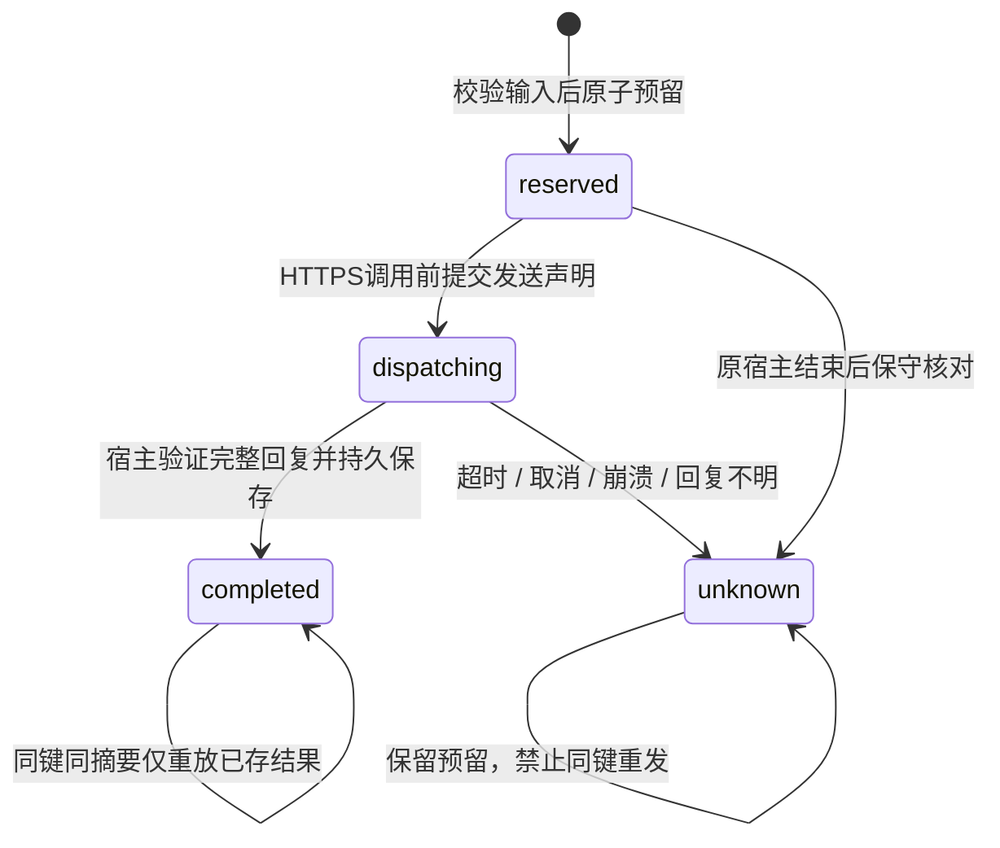

# CimiLoop 宿主模型网关与持久预算 v0.1

2026-10-04，V1-09续批，决策D-199。宿主HTTPS网关核心、请求前的持久预算预留、严格请求 / 回复校验及CLI合成探针已实现。D-198的AppContainer IPC与本批网关尚未桥接；本批没有启动OpenCode，没有读取真实Key，没有调用外部模型。真实Provider的可靠费用上界、正式受控执行与Agent Run仍未开放。协议保持2.0.0，领域数据库保持格式8，没有升级用户库。

2026-10-05后续D-200已完成[IPC宿主网关桥接](CimiLoop-IPC宿主网关桥接-v0.1.md)，无网络OpenCode实际收到合成HTTPS回复；本文件与原实测保留D-199阶段事实。真实模型计价及正式执行继续按后续步骤验收。

## 1. 已实现的宿主核心

`model-gateway.ts`仅开放SyntheticModelGateway：固定测试主机`cimiloop-gateway.test`、宿主绑定端口、POST路径`/v1/chat/completions`和模型`cimiloop-synthetic-text`。请求只允许UUID请求键、操作键、固定模型、最多32条system / user / assistant文本消息及1–128的输出Token限制。URL、Host / Authorization等请求头、工具、多模态、代理、CONNECT和其他字段均拒绝。

宿主使用Node24.15.0的HTTPS请求接口，TLS验证保持开启，测试主机名与服务器证书匹配，测试证书由宿主固定摘要。连接只走该探针自己建立的`127.0.0.1` TLS服务，不安装系统信任根或修改证书库；仓库内证书私钥是公开的测试夹具，不能用于实际Provider。请求不会接受任意主机或私有地址替换，Node不自动跟随重定向，代码也没有网络重试。专用Agent关闭连接复用，固定`stream=false`、`n=1`和请求输出上限，不读取代理环境变量。

完整请求与上游响应各限16384字节；响应按累计接收字节检查，既检查Content-Length，也拦截超过上限的分块响应。总时限默认5000毫秒，不只限制连接等待；取消同时销毁请求。响应必须是未压缩的JSON，严格UTF-8，只有批准模型、单个完整文本结果、stop结束及一致的整数Token观测才允许完成。上游回复含凭据时拒绝，不写入正常结果。错误只保留固定原因，不记录消息、Key、Authorization或上游错误正文。

真实模型连接入口`requireDedicatedGatewayBilling`在读取DPAPI文件、创建账本、DNS或连接前，以`gateway_reliable_billing_profile_unavailable`拒绝实际智谱连接。未来公网路由用的地址分类辅助函数已有IPv4 / IPv6回归，但尚未实现或验收生产DNS解析、固定地址和重绑定防护。不能把合成测试主机固定机制视为实际公网主机白名单已验收。

## 2. 持久预留及未知结果

宿主私有账本使用独立SQLite文件；application_id固定为`0x43494d47`、user_version为1，不接受其他应用或领域数据库。WAL、synchronous=FULL与BEGIN IMMEDIATE提交确保两个进程不会同时消耗最后一笔预算。预算键对应的策略摘要、币种、总量和单请求预留一旦保存就不能原地增加或替换。



预留与发送声明都在任何HTTPS请求前提交，已由接收端读取账本状态验证。请求ID在该预算内唯一，输入摘要包括操作键；同键不同输入直接冲突，未完成或Unknown键不能重新发送。Completed结果跨宿主实例从账本重放，并核对回复摘要与结构，不消耗新的预算。

本批仅使用TEST单位。合成上界为`16384 × 2 + 128 × 5 = 33408`微TEST单位，每个已预留请求持续占用全部上界。Completed也不根据较小的Token观测释放差额；HTTP错误、TLS失败、断流、超时和取消一律保留预留。上游输出或输入Token观测超过冻结上界时，阻止该预算的所有新请求。账本每个预算最多4096条请求，不支持任意清空、滚动重置或Unknown自动返还。

`reconcileEndedOwner`仅用于原宿主已结束后的核对，把Reserved / Dispatching转为Unknown，不改变占用金额；本批测试原进程自行退出，并在确认其close事件后核对。该方法没有自动识别OS归属或判定活进程结束，正式桥接恢复必须接入既有准确PID / 创建时间 / 程序身份核验，不能直接对活宿主调用。

TEST金额既不是microusd，也不是实际账单；`cost_known=false`始终保持。真实计价还需要固定Provider / 账号 / 模型 / 币种 / 有效期、可信输入Token上界、输出及推理Token限制、缓存 / 附加收费、失败计费规则和可核对的账单依据。Coding Plan订阅额度不能直接折算为零美元或普通API单价。现有RuntimeExecutionPolicy的host_allowlist和required_cap继续在启动前拒绝。

## 3. CLI与证据

```powershell
pnpm cimiloop --json runtime gateway-probe --output-dir '<合成宿主探针目录>'
```

命令不接受实际连接、Key、任意端点、Runtime二进制或执行策略覆盖，默认目录为`.cimiloop/gateway-probe/`。每次在`runs/<UUID>/`保存独立TEST账本及宿主观测，顶层保存最新结果；历史探针保留，不重置原预算。通过退出0，检查不通过退出1，参数错误退出2。

新增RuntimeGatewayProbeResult / RuntimeGatewayBudgetSnapshot是独立的2.0.0 Schema，不改变已有RuntimeOperationResult或RuntimeProbeResult。结果固定scope=`synthetic_gateway_probe`、币种TEST、`cost_known=false`、`ipc_runtime_connected=false`、`actual_credentials_read=0`、`external_model_requests=0`及`formal_execution_enabled=false`。结果解析器同时核对完整12项检查、通过状态和预留聚合。宿主观测以SHA256原始引用保存，仅包含固定路由、请求体摘要和预算快照，不含原始提示词或凭据。

该格式不能替代D-194真实模型契约结果，现有Provider证据导入也不接受它为受控执行ALLOW。它不会创建Task、Run、Binding、Gate或领域Receipt。

## 4. 验证与下一批

实际CLI的12项检查全部通过：固定HTTPS路由、持久重放 / 冲突、预留前拒绝、并发预算、重定向 / 异常JSON / 用量超界、总时限、取消、不可信TLS无HTTP发送、结束宿主核对及真实计价拒绝。测试包括独立双进程竞争、接收端确认预留先于HTTP、分块超长回复，以及实际HTTP已送达后宿主异常退出、原请求不重发 / 预算不返还；后两种进程场景另保存了真实合成宿主观测。Node24.15.0 + pnpm12.4.2下构建、类型检查、Schema同步及全量35个测试文件358项通过，新增30项网关 / 预算 / CLI回归；专项3个测试文件61项通过。

实测与固定源摘要见[宿主网关实测快照](../research/CimiLoop-宿主模型网关与持久预算-2026-10-04.json)。构建和接口依据固定[Node24.15.0 HTTPS文档](https://nodejs.org/download/release/v24.15.0/docs/api/https.html)与[SQLite文档](https://nodejs.org/download/release/v24.15.0/docs/api/sqlite.html)；能力结论来自本批代码及实际测试。

后续D-200已完成[IPC宿主网关桥接](CimiLoop-IPC宿主网关桥接-v0.1.md)：冻结模块及策略、准确原生归属、无网络OpenCode响应、取消 / 原生或宿主崩溃和Unknown预算保留已验收。本文件保留D-199宿主核心阶段事实及原实测。下一步建立真实Provider可核验的计价上界及公网DNS / 固定地址 / 重绑定防护，再做真实网关契约验收；补齐文件系统硬配额与完整恢复后接正式Task及Agent Run。 Matt / Superpowers技能包装仍属S1的V1-21/22，OpenSpec可选，ECC按需参考。

2026-10-05后续D-201已实现固定智谱Coding Plan公网DNS / 一次性地址固定及TLS对端核验，实际两条A / 两条AAAA与所选IP的TLS1.3验证通过；新增有期限的GLM-5.3积分估算及计费缺项查询。公网连接探针的模型端点HTTP、真实Key读取和外部模型请求0，未启动Runtime。积分估算不作为实际费用或准入证明，真实网关计费与正式Task / Agent执行仍未验收。 见[公网网关边界与积分估算](CimiLoop-公网网关边界与积分估算-v0.1.md)。下一步确认专用连接的套餐版本及网关适用环境，建立包含思考Token的输入 / 输出上界、积分与现金预算的明确关系及持久预留，再验收真实HTTPS / Runtime契约；文件系统硬配额与完整受控恢复仍待完成。 本批仅验证连接层，既有真实Runtime host_allowlist / required_cap保持拒绝，Provider受控执行不提升。

2026-10-05后续D-202已实现独立持久积分演练账本、共享账户 / 任务累计上限、一次发送凭据、历史回执及原宿主身份核验后的恢复。实际三个独立宿主验证共享上限CAS与发送状态提交后的进程退出；15项CLI检查通过。HTTP、真实Key及模型请求0，真实计费准入与正式Task / Agent仍未启用。 见[持久积分预算与宿主恢复](CimiLoop-持久积分预算与宿主恢复-v0.1.md)。下一步确认套餐版本与网关工具资格，证明服务端输入及思考输出上界，固定实际账户唯一账本、配额 / 账单核对及Task现金 / 积分预算关系，再实现真实HTTPS请求契约；文件系统硬配额和完整受控恢复仍待完成。
